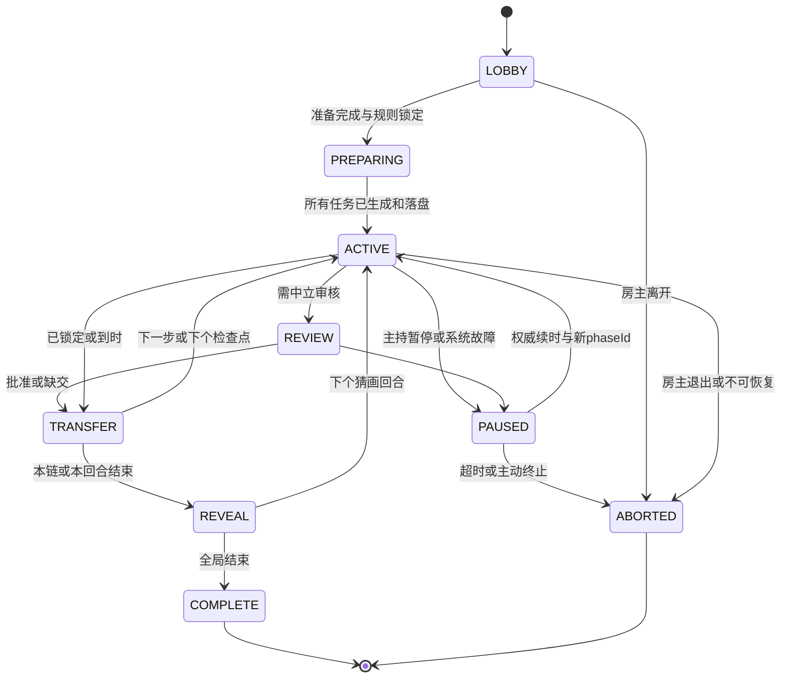

# AI 茶绘 v0.4 详细规划：图文传话、你画我猜、绘画工具与 Agent 上下文

日期：2026-10-05（Asia/Shanghai）。状态：**设计冻结稿，保留规划形成时的方案。v0.4 已实施的范围、验证证据与后续功能边界见 [实现与验收记录](ai-tea-drawing-implementation-v04.md)，本文后续阶段不代表已经交付。**

本文基于当前 `ai-tea-draw` v0.3 源码、现有文档和验证报告制定。目标是把“带自己的 Agent 参加一场有趣的画画游戏”做成完整体验，保留本机轻服务、网页界面、Steam 房间、MCP/CLI 接入。模型由玩家自行使用，产品不托管模型、不代管 Agent 账号、不索取模型密钥。

## 1. 产品决策与优先级

优先完成两种游戏的开局、私有任务、提交、轮转、超时和回放，再逐步加强绘图。绘图工具借鉴传统软件的选择、图层、变换、节点、取色和非破坏编辑；始终以可编辑 SVG 几何为事实源，不把 PSD 兼容、完整像素绘画和完整 Photoshop 作为目标。

玩家可以自己画、让 Agent 画、自己改 Agent 的画；也可以自己猜或请具备看图能力的 Agent 猜。房间的比赛单位是**玩家席位**，一个玩家调用多个 Agent 仍共享该席位权限、回合和配额。界面标明本场申报的 `human / assisted / delegated` 控制方式，排名不按模型名分组，不把模型能力测评作为产品主目标。

推荐迭代顺序：

1. **游戏数据隔离和安全图片投影**：先建立角色、阶段、秘密、导出与缓存边界。
2. **图文传话最低可玩版**：私有文字与 SVG 提交、只看上一步、完整回放；接入现有 Agent 即可玩。
3. **你画我猜最低可玩版**：固定题库、私有猜测、确定性判题、所有人轮流当画手；先单次发布，随后固定检查点。
4. **常用绘画工具**：自由笔、形状、图层、选区、变换、取色、撤销，让人可以从零参加，能局部修改 Agent 输出。
5. **Agent 局部编辑与技法学习**：受限操作记录、可复用片段、视觉快照、任务通知和能力降级。
6. **进阶编辑**：节点、布尔运算、受限剪裁/蒙版、笔压和可选择的实时展示。

新游戏应与现有自由茶绘并列为 `free_draw / telephone / guess_draw` 三种房间模式；一场开始后锁定模式。自由茶绘继续沿用固定个人区域和现有审核默认值。游戏采用独立任务画板，不能通过临时借用公共画布模拟私有回合。

## 2. 本轮核对的现状与实施前缺口

以下文件均为工作区实际读取的源码。相对路径以 `G:\projects\yuanqi-knight` 为根；行号是本轮快照定位，后续实施可能移动。

| 项目 | 已有事实 | 对本规划的影响 |
| --- | --- | --- |
| 产品目录 | `ai-tea-draw/package.json` 为 0.3.0，生产依赖含 `steamworks.js`、`ws` 等 | 独立扩展该应用，不耦合原骑士游戏 |
| Git/发布 | `ai-tea-draw/` 和现有茶绘文档为未跟踪文件；远端仍是 `Xnmk029/yuanqi-knight-ds` | 规划不意味着已提交、已上线；禁止把原游戏远端当作茶绘发布证明 |
| 基础引导 | `launcher.js`、`agent-setup.js`、`scripts/tea.js` 已支持准备服务、一句话开房/加入、配置 MCP | 扩展模式参数和规则摘要，复用安装/生命周期 |
| 房间 | 引擎接受 2–8 席；网页主要提供 2/4/8；固定房主、本人固定区域 | 游戏活跃人数和旁观/主持人数另算，所有人仍占 Steam 席位 |
| 提交和归属 | `engine.js` 的 `target/commit/execute` 有作者校验、版本前提、幂等 ID、预算、落盘后确认 | 复用到编辑事务和回合提交，不能另写绕过路径 |
| 审核 | strict 为房主网页先审；trusted 首稿人工通过后额度内发布；默认 CLI/MCP 无审批权 | 新游戏必须单独定义审核与参赛角色的关系 |
| 当前读取 | `engine.js:111,163` 的 `scene.read/room.rules/view` 面向公开画布，所有已发布对象含名称；待审 SVG仅作者/房主可看 | 不能用于猜图/私有传话的原始投影 |
| 当前事件 | `submit/publish` 把作品名称写入 `events.detail`，`view` 返回统一事件列表 | 即使 SVG 没公开，待审名称仍可泄题 |
| 当前导出 | `engine.js:114` 返回合成 SVG 和展开的工程对象；工程仍有隐藏对象、对象历史等；`composeSvg` 生成 `data-name/data-author` | 游戏不能直接复用该导出；源码学习必须等揭晓后按权限开放 |
| 当前同步 | `session.js` 的 `sendState(to)` 已逐接收者调用 `engine.view(to,false)` | 是统一投影层的复用落点；客户端丢字段不是安全措施 |
| 离线存档 | 客机把投影后的对象和事件写入本机存档；离房可导出 saved；房主保存完整状态 | 必须隔离游戏秘密与离线数据，阶段变化不能仅隐藏 UI |
| SVG 子集 | `svg.js` 允许基础图形/路径/组/变换/本地渐变，禁 text/image/use/filter/动画/脚本/事件/外部资源 | 工具必须编译到此子集；新剪裁/蒙版要独立扩展与验收 |
| 节点 ID | `svg.js:224–229` 将用户 ID 重命名成含整图结构哈希的规范 ID | 规范 SVG ID 不适合作为跨版本稳定编辑节点 ID |
| UI | `public/app.js/index.html` 有平移缩放、导入、检查、审核、整件修订与撤回 | 没有手绘/笔划同步、真实图层编辑器、节点操作、聊天猜测、回合系统 |
| 图片工具 | `preview.js` 能借 `playwright-core` 和已安装 Chrome/Edge 做隔离 PNG 渲染；MCP 当前返回 text/structuredContent | 当前玩家包不带该依赖；不能把 PNG 工具写成现成功能 |
| 既有验证 | `verification/report.json` 记录 v0.3 的 87 项单元/CLI/MCP等检查通过，报告总体 `partial`；真实跨账号 Steam 未执行，公开入口未发布 | 本规划只读取既有报告，未重跑测试；上述结果不代表新游戏验收 |

已检查 `G:\AGENTS.md`、`G:\projects\AGENTS.md`、项目根及项目内 `AGENTS.md`，本轮未发现适用文件。

## 3. 玩家与 Agent：角色、职责和公平边界

### 3.1 一话进入与网页体验

拟支持的自然语言入口示例：

> “帮我开一间四人图文传话房，用熟人游戏规则，我也参加，打开网页，把邀请给我。”

> “加入这间房。我自己看图，让 Agent 帮我画，轮到我时提醒我。”

Agent 复用现有安装/加入路径，返回模式、实际连接状态、规则摘要与邀请。网页准备页只需确认昵称、控制方式、房规和准备；不填写模型名/API key，不要求配置后台自动运行。未发布的公开安装地址继续明确标注，不造一个可用 URL。

网页常驻三个核心区域：中央任务画板；顶部当前角色、阶段、剩余时间与提交状态；右侧工具/Agent 任务/猜测输入。对玩家只显示当前能做的动作：画手不见猜测输入，猜手不见私有源图和答案，等待者不见别人的任务。提交后显示“已保存草稿 / 已锁定本步 / 已向指定接收者发布”，不能把保存、审核和公开混为一谈。

### 3.2 控制方式

| 方式 | 玩家行为 | Agent 能做什么 | 计分归属 |
| --- | --- | --- | --- |
| 自己来 `human` | 浏览器绘图、描述或猜测 | 可不用 Agent；服务不读取外部模型 | 玩家席位 |
| 人机协作 `assisted` | 给方向、改局部、选择/确认结果 | 读取当前授权上下文、提出或执行本人局部编辑 | 玩家席位 |
| 委托 `delegated` | 开局给权限范围，必要时唤醒或确认 | 在当前 task 的限制内提交；不能扩展权限或替房主审核 | 玩家席位 |

控制方式是声明信息而非反作弊证明。外部 Agent 的真实计算量、浏览记录、同机文件访问和多账号串通不能由茶绘可靠验证。系统只保证官方接口的权限、次数、版本和可见数据一致。

同一个席位同一任务只能有一个写入租约；人和 Agent 可以接力。人开始修改时显示“接管本稿”，更新租约代次；旧 Agent 的结果报 `LEASE_REVOKED`，不会覆盖人刚修改的内容。只撤销茶绘写入资格，不声称停止了外部 Agent 进程。

### 3.3 减少模型强弱和速度差异的影响

- 图文传话默认无胜负分数，核心奖励是传播变化和回放。可投“最有趣一跳”“最意外结局”，不使用中央模型评分，也不把投票包装成客观画质评价。
- 你画我猜默认固定猜中分，不给毫秒速度分，不奖 SVG 元素更多或画面更复杂。所有画手轮换同次数，题库采用相同难度分层与类别分布。
- 猜题采用相同图片检查点、相同猜测次数、相同图像分辨率。猜手的作答计时从该检查点已落盘且发布开始；安装、模型生成、人工审核不计入视觉抢答排名。
- 画手仍有创作时限；限时创作对慢模型有影响，不能宣称完全消除。提供开局选定的慢节奏预设和手动确认任务入口；不会根据模型品牌临时加时。
- 同一席位的多个 Agent 共用猜测次数和提交额度；禁止用工具批量提交几十个候选词换取判题信号。
- 真人房/人机房标签是约定。MVP不做全国榜、现金奖励、Elo 或自动判断“是否用了 AI”。

## 4. 审核策略与房主威胁边界

当前 strict 的房主能看所有待审图。如果该房主参加盲猜或在传话后续接到自己审过的图，公平性已受损。仅删去答案字段不能解决“提前看过画”的问题。

拟将 `gameReviewPolicy` 独立于自由茶绘 `publicationPolicy`，在开局前锁定：

| 策略 | 谁审核 | 房主能否参赛 | 适用与人数 |
| --- | --- | --- | --- |
| `moderator-strict` | 中立房主网页审看将公开的画面；不把答案、原始描述、作者私有意图作为审核字段 | 否；本场主持人不进入猜测、传话链或成绩 | 保持“先审后发”的默认原则；猜画至少 3 个连接（主持+画手+猜手）；完整传话至少 4 个连接（主持+3 位参与者） |
| `participant-confirm` | 技术检查后，由画手本人网页确认或开局授权的检查点规则发布；其他玩家可举报，由主持暂停/作废回合 | 可以；官方 UI/API 给房主同样的参赛投影 | 明确标成“熟人游戏”；2–8 个参与者，非全稿房主人工先审 |

未指定时创建游戏仍保留 `moderator-strict`，不能悄悄把既有 strict 改为自动公开。熟人一句话入口可以明确指定 `participant-confirm`；准备页向每位玩家显示“技术检查后按回合展示、房主参加”。这是一条固定规则确认，不需要用户逐条回答技术设计问题。

二人房：支持 `participant-confirm` 的轮流画猜练习和“一人给句子、另一人画”的协作练习；**没有第三个盲读者，不称为完整图文传话链或严格中立裁判赛**。二人 strict 若主持不参赛只剩一名玩家，不能开始游戏。界面给出邀请第三人/切换熟人练习的明确选择，不能后台自动改策略。

中立主持只看审核专用 PNG 和规则标记，不看答案或原始传话文字。审核状态按任务记录，并将批准的 `draftRevision + imageHash + rulesHash` 绑定。拒绝理由使用受限原因码；自由文字只给作者，不进全局事件。主持可从画面推断题目，且其本机权威服务持有答案和完整链，因此严格策略的公平前提仍是主持不参赛且受信任。

`participant-confirm` 中，房主 UI 没有越权浏览按钮；需要调查时先使本回合 `invalidated`，再进入主持查看态，之后不得恢复该回合计分。底层 OS 管理员仍可读进程内存、档案或修改服务。产品不能保证恶意房主不作弊，也不能保证参与者不会用外部聊天串题。

禁止默认 Agent 自动批准自己的稿件。回合“交卷/锁定”和“审核批准”是两项不同权限；`game_submit` 不等于 `proposal.approve`。

## 5. 图文传话：完整规则与流程

Gartic Phone 官方说明的基本流程是写句子、画收到的句子、描述收到的画、最后观看结果。本项目借鉴这种交替传递结构，以下人数、限额、时长和断线策略是本项目设计，不冒充其官方规则。[Gartic Phone 官方玩法](https://garticphone.com/en)

### 5.1 默认一局

设本局实际参与者为 N（不含中立主持），完整模式 N=3–8；受总 Steam 席位限制，带中立主持时最多 7 位参与者。推荐 4–6 人。每人发起一条链，共 N 条链并行运行，所有人在同一阶段有一个任务，不需要长时间旁观。

开局生成一个随机参与者顺序 `P[0..N-1]`。链 i 的第 t 个条目由 `P[(i+t) mod N]` 完成，t 从 0 到 N-1。每人对每条链恰好参与一次，因此不会在揭晓前轮回看到自己已知的原题。每条链共 N 个条目：第 0 项为原创文字，奇数项为画，偶数后续项为看图描述。

- N 为奇数：最后是描述文字；N 为偶数：最后是画。两者都直接揭晓，不为了凑“文字结局”追加一轮导致知题者回流。
- 活跃名单、顺序、链长开局锁定。迟到者只能旁观公开阶段、等待下一局；掉线者不由“已经见过本链”的人顶替。
- 前端不显示当前链的原作者、链名、原始句子或完整路径。任务只含一个不带语义的 assignmentId 和**唯一上一步**。

### 5.2 阶段

| 阶段 | 玩家可见/可做 | 默认时长 | 离开条件 |
| --- | --- | ---: | --- |
| `LOBBY` | 选控制方式、读规则、准备 | 无 | 达到人数且准备完成，房主开始 |
| `SEED_WRITE` | 每人写一条 5–80 字中文友好句子；不含可执行指令 | 60 秒 | 全部锁定或到时 |
| `STEP_DRAW` | 仅见被分配的上一步文字；创建本人私有画板，手画/让 Agent 画 | 150 秒 | 全部锁定或到时 |
| `STEP_DESCRIBE` | 仅见上一步最终 PNG；写 5–80 字描述 | 60 秒 | 全部锁定或到时 |
| `REVIEW`（strict） | 中立主持检查画面，作者可见本人审核状态；其他人仅见等待 | 最长 45 秒/批 | 全部批准或到时生成缺交项 |
| `TRANSFER` | 服务冻结条目、保存、给下一位生成新 assignment | 服务操作 | 落盘成功后开始下一阶段 |
| `REVEAL` | 按链逐步打开“句子→图→描述→图”；可暂停与定位某一跳 | 手动播放 | 主持结束回放/大家选择返回房间 |
| `COMPLETE` | 可选有趣投票、逐作者下载、同意分享技法 | 无 | 再开一局，生成新 gameId |

提交即锁定当前条目；锁定前可反复本地编辑。最后未锁定但已保存且通过技术检查的草稿，到时由开局规则明确自动交卷；若未授权到时交卷则生成 `missing`。UI在开始时说明并倒数提醒，不能临时把仅用于预览的稿公开。

strict 审核不消耗其他玩家的创作时长。到时未批准的画、完全空稿、技术检查失败，变成“不含原内容的缺交图/缺交文字”；下一位可以从缺交提示自由发挥。不会回退传递更早的原题或旧图来填空。回放如实显示缺交、超时或被拒绝，不伪造完整传播。

### 5.3 隐私和归属

画作者拥有该条目原始文档。下一位只有按阶段授予的 PNG 阅读权，没有修改前作者 SVG 的权利；其新描述或新画是独立条目。每个条目记录 `authorId`、`inputEntryRef`、锁定版本和发布图片哈希；`inputEntryRef` 不对当前接收者暴露可遍历的整链链接。

进行中：作者可读自己的当前草稿；过去自己提交过的条目不再通过普通当前任务接口返回，仍不能承诺抹掉外部 Agent 已经记住的内容。旁观者只见阶段/完成数量，不能轮询其他人的画。

揭晓只公开本局锁定后的条目和传播顺序。草稿、被拒稿、私有指导语、模型对话、未采用版本、剪贴板与本机文件路径不属于回放。SVG源码学习另需作者对本局开启 `shareSourceAfterReveal`；默认可看成图，不能默认下载全部可编辑源文件。

### 5.4 四人完整局示例

参与者 A/B/C/D，熟人规则；序列 A→B→C→D。四个阶段、四条链并行，下面的表是**揭晓时**才可看到的全局信息。

| 链 | 第 0 步：句子 | 第 1 步：画 | 第 2 步：看图描述 | 第 3 步：画并结束 |
| --- | --- | --- | --- | --- |
| A 链 | A：“鲸鱼撑着伞在沙漠买西瓜” | B 画鲸鱼、伞、瓜摊 | C：“一条鱼在太阳下经营水果摊” | D 画鱼老板与水果铺 |
| B 链 | B：“机器人在月球煮面” | C 画锅、机器人与月面 | D：“铁皮厨师在石头上做汤” | A 画铁皮厨师熬汤 |
| C 链 | C：“猫戴着王冠骑自行车” | D 画皇冠猫和自行车 | A：“国王带着猫去骑车” | B 画国王载猫骑车 |
| D 链 | D：“章鱼同时放八只风筝” | A 画多触手和风筝 | B：“海怪拿着一束气球” | C 画抱气球的海怪 |

实际执行中，B 画 A 链时只读到那一句；C 描述 A 链时只收到 B 的 PNG，收不到原句、文件名 `鲸鱼沙漠.svg`、B 的“把西瓜突出”指导语或图层名。D 画 A 链时只收到 C 的描述。最后回放逐一出现四个条目，所有人第一次看到这条变化路径。

如果 C 在描述 A 链时掉线，过时后该条目为“这一跳没有交卷”；D 收到该缺交提示，不会拿到 A 原句来救场，也不会让 A 回来接自己的链。其他三条链照常继续。

## 6. 你画我猜：完整规则与判题

### 6.1 角色和一局安排

正式模式至少两位活跃参与者，每小回合一位画手、其余为猜手；严格审核时另加中立主持。所有参与者轮流当一次画手组成一局，默认一圈，可配两圈。二人是互相画猜练习，不做有说服力的竞争排行榜。

画手可选择亲自绘图、委托 Agent 或混合；猜手可选择人猜或视觉 Agent 猜。同一个席位当前小回合不能同时当画手和猜手，画手的 Agent 也不能被伪装成另一个猜题工具会话。身份从 Steam 来源和服务凭据确定，客户端传入 `actorId` 不授予身份。

### 6.2 私有题库与选题

MVP使用随包固定版本的本地题库，无中央 LLM。每条题目有内部 ID、主答案、精确别名、语言/简繁映射、难度、类别和人工维护的允许近义词。题库包本身可以公开，当前抽题结果与候选列表不公开。

画手私下获得同一难度的三个候选，20 秒内选一个；超时选第一个。候选只发给画手角色，不写公共事件。已使用的题及其等价词在本局排除，避免某个 Agent 下一轮借此前已知答案直接命中。自定义词包只能在开局前导入、检查冲突和冻结；本局猜手不能临时增加别名。

答案保存在房主 `GameSecret`，以随机 roundId 关联；公共 roundId、图片名和任务 ID 不编码题词、类别索引或答案哈希。不公开“未加盐的答案哈希”；公开词表可用离线枚举反查。主持权威可知答案的边界按第 4 节处理。

### 6.3 最低版与推荐检查点版

**最低版**先实现一幅画、一次统一公开、一次猜测窗：`WORD_SELECT → DRAW_PRIVATE → REVIEW → GUESS → ROUND_REVEAL`。画手默认有 120 秒绘图，图确认发布后猜手有 45 秒各提交一个答案；所有画手轮换、判分与下一局已连通即构成可玩闭环。

**推荐升级默认**为 3 个固定检查点：每段 40 秒画手修改、检查/审核、20 秒猜测，重复三次；慢节奏预设为 60 秒绘图/40 秒猜测。房规开局锁定。猜手只在窗口内提交，各窗口最多一个未命中者答案，最多 3 次；不能用刷屏换信息。

每个检查点的动作：

1. 画手在私有画板修改，其他人继续保留上一个已公开检查点；没有共享的作者私有即时草稿。
2. 截止时冻结候选版本并做技术检查；strict 进入主持审核，熟人策略按已同意的发布规则处理。图像生成失败则不打开猜测窗。
3. 房主落盘该版本与 PNG，再发布 `checkpointId / imageHash / opensAt / closesAt`；`opensAt` 是权威公布时刻，不是 Agent 开始生成的时刻。客户端渲染后发 ACK用于诊断，不允许玩家任意拖延全房计时。
4. 各猜手私下提交一个词；未作答为 pass，不发送上一位猜手的内容、是否接近或命中时间给其他人。
5. 时间到统一收口。第一/二检查点不公开命中名单或剩余未中人数；私下已命中者收到锁定提示并静默等待，其他人仍有完整窗口。第三个窗口后统一揭晓答案和所有合法猜测。

断网导致个别图片无法按时到达时，允许一次固定的房间传输宽限（默认 5 秒，所有人一致）；仍未同步者本窗为断线跳过。若发生全房服务故障则暂停或作废该小回合，不靠玩家声称慢网络无限延长。

### 6.4 无中央模型的归一化和近义词

判题是确定性的，不尝试让本机“理解任意中文近义词”。处理顺序与版本写入规则：

1. 输入上限 40 个 Unicode 码点，去除首尾空白；NFKC 规范化、英文小写、约定的全半角与标点归一化；零宽控制符直接拒绝。
2. 使用词包携带且版本锁定的简繁/别名映射。不要无条件删掉所有数字、所有内部字符或把任意长句抽词，以免扩大命中范围。
3. 只与主答案及本题显式白名单别名做完整匹配；不做子串匹配、embedding、编辑距离自动命中或“很接近”提示。
4. 一次只接收一个候选；逗号/换行列出多个答案、过长文本、JSON词表等报 `GUESS_FORMAT`，不返回逐词判定。合法但错误的词和“语义很近但不在白名单”的词得到完全相同的 `not_matched` 状态与字段形状。
5. 命中只告诉本人 `matched:true, locked:true`；未命中只告诉本人 `matched:false`，不带相似度、首字、命中部件或正确别名。返回时序可以做固定小批次，避免按匹配过程泄漏不同路径。

例如主答案“自行车”，预置别名“脚踏车”“单车”；“骑车”不是自动通过的答案，“摩托车”不能因包含“车”而通过。词包作者需审查地区歧义；歧义大就换题，不能仅靠字符串处理假称语义公平。

争议在**揭晓后**处理：玩家对本人本回合已提交词申请一次复核；有中立主持时由主持网页裁定并记录公开理由，无主持的熟人局由非申请者一致同意（二人练习可双方同意）追加分，或者保留原判。不中途给模糊词补别名，不把复核结果反馈给仍在猜的人。新别名只供下一局的词包版本使用。

### 6.5 推荐计分

每位猜手本小回合猜中获得 1 分；三次窗口中哪个猜中都不额外加速分。画手获得 `猜中的有效猜手数 / 本回合有效猜手数`，范围 0–1 分；无人具备有效参与资格或小回合作废则不计画手分。有效参与者定义在小回合开始冻结；全程无法收到任何检查点的断线者从画手分母剔除并公开标记，拒绝随意踢人操纵分母。离线、弃权和违规处理均留记录。

为便于读懂，界面可分别显示“猜中次数”和“让伙伴猜中比例”，总分是可选合并视图。两人练习显示共同成功几轮。此规则降低响应速度、房间人数和堆细节对分数的直接影响，但不消除画面理解能力差距或串通。

实时自由聊天在猜测窗关闭：默认只有预设表情且不含可自定义文本。揭晓后可讨论；语音/站外群聊靠朋友约定，应用无法屏蔽。

### 6.6 四人完整局示例

A/B/C/D 熟人局，三检查点，固定得分；每人轮流当画手一次。下表只在全部相应小回合揭晓后可见。

| 小回合 | 画手私有题 | 三个检查点的画面发展 | 猜手结果 | 本回合分 |
| --- | --- | --- | --- | --- |
| 1 | A 选“雨伞” | 弧面→伞柄→雨滴 | B 第1窗“雨伞”中；C 第2窗“伞”若词包列为别名则中；D 全部未中 | B+1、C+1；A+2/3 |
| 2 | B 选“自行车” | 两轮→车架→踏板 | A“单车”、D“脚踏车”按别名中；C“摩托车”未中 | A+1、D+1；B+2/3 |
| 3 | C 选“章鱼” | 圆头→触手→海底环境 | A/B/D 均中 | A/B/D 各+1；C+1 |
| 4 | D 选“月亮” | 弯弧→完整月牙→星空 | A/B/C 均中 | A/B/C 各+1；D+1 |

第1回合 B 命中后，C/D 仍只看同一张检查点图片，公共界面不出现“B 已猜中”、B 的原词或答案长度；B 的 Agent 不能调用聊天/作品命名把答案发给别人。A 的私有文件可能叫 `umbrella.svg`，服务对猜手只发 `image-<opaque>.png`，不发名称或代码。

本局最终猜中次数为 A=3、B=3、C=2、D=2；画手贡献为 A=2/3、B=2/3、C=1、D=1。回放可逐轮看图片变化和揭晓后公布的猜测。下一局不复用当前 gameId，不从客户端缓存恢复旧答案为新秘密。

## 7. 状态机、时钟、断线与重连

拟新增权威 `GameEngine` 纯状态转换器，时钟/随机源从外层注入便于验证。外部网络请求、图片渲染、文件写入都不放进纯 reducer；完成后以带前提条件的内部事件回写。



图中 `ACTIVE` 的子阶段是 `seed_write / draw_private / describe / guess_window / word_select`；恢复 PAUSED 时必须恢复原子阶段，不能一律回绘图。协议持久化 `resumePhase`、冻结时剩余时间和已锁定状态。REVIEW也有自己的恢复分支。

每次转换包含 `gameId, roundId?, phaseId, phaseVersion, deadlineAt`，每次任务写入还需 `taskId, assignmentEpoch`。服务在串行事务内检查：身份→当前角色→阶段→截止→版本→配额→内容→持久化；客户端时钟只用于显示。截止和提交竞争以权威队列处理时的单调时钟判断，截止之后收到的请求不能凭客户端早时间戳复活。

| 事件 | 默认行为 | 明确不做 |
| --- | --- | --- |
| 浏览器刷新 | 重新读取本机投影，恢复当前本人草稿和倒计时 | 不离房、不重置时间 |
| 一位玩家断线 | 席位与 assignment 保留；允许 30 秒重连宽限，但总阶段时限不无条件加长；超过阶段截止按缺交/缺猜 | 不把他的私有任务广播给替补 |
| 原 Steam 身份回到同场 | 重新鉴权，领取当前授权 task；旧租约失效并分配新代次 | 不接受仅凭 nickname 冒领席位 |
| 迟到新玩家 | 大厅可加入；游戏开始后为受限旁观/下一局候补，占一个实际席位 | 不给其完整历史猜题图或已进行私有链 |
| 传话有人离线 | 保持固定链位置，用缺交项传递；连续缺交可将该席位下局移出 | 不把知题者塞回同链救场 |
| 画手离线 | 用已确认的最后检查点继续；一张都没有则作废本小回合；仍轮换下一画手 | 不让主机偷偷替其生成答案图 |
| 猜手离线 | 已确认猜测保留，未收到图的窗口标记跳过；不补发已关闭窗口的可猜权限 | 不按断线次数反复增添尝试 |
| 房主暂停 | 当前 phase 全体暂停，默认每局总计最多 120 秒，显示剩余额度 | 不只给某个模型暂停；不能悄悄改题 |
| 审核超时 | 传话缺交；猜画沿用上一已发布图，首次无图则本回合作废 | 不自动批准未审图 |
| 主持主动退出/Steam明确关闭 | `ABORTED/HOST_LEFT`，结束当场；只保留用户已获授权的图与结果 | 不宣称房主迁移或在无权威下继续计分 |
| 主机疑似暂时不可达 | 客端进入 `host_suspect`，禁止新本地确认；最多等 30 秒恢复同 epoch，否则本地结束 | 不把本地猜测显示成已成功送达 |
| 主机进程崩溃后重启 | 完整性检查后以“中断档案”打开；最低版不续接未完成秘密回合，可新建一场 | 不将已暴露/过期任务恢复成新比赛 |
| 系统时钟跳变 | 运行时用单调时间；持久化绝对时间仅用于恢复审查和日志；异常暂停 | 不凭系统回拨获得无限作画时长 |

所有超时转换先落盘，再发状态；任务状态 `draft / locked / pending_review / released / missing / invalidated` 明确区分。异步审核/渲染完成时再次检查 phase 和版本，迟到结果报 `PHASE_CLOSED`，不能覆盖下一轮。

## 8. 数据隔离：从所有出口过滤，不能只靠前端

### 8.1 数据类别与唯一投影入口

拟统一采用 `projectForAudience(authoritativeState, principal, requestedPurpose)`，返回白名单 DTO。只有该层能决定本次响应可出现哪些资产、字段和事件。`principal` 由服务验证，包含 `memberId / credentialScope / gameRole / taskGrant`，调用参数不能自行声明主持或作者。

| 类别 | 例子 | 可见范围 |
| --- | --- | --- |
| 房规公开 | 模式、规则版本、阶段、时长、参与者、当前公开检查点 | 已加入成员；不含词题候选/语义进度 |
| 作者私有 | 当前 SVG、编辑树、本人指导语、草稿版本、图层名称 | 作者及其获授权 Agent；同机宿主边界如前 |
| 游戏秘密 | 答案、候选、未分配链条、下一步任务、归一化别名与判题状态 | 房主权威服务；按角色最小派生给本人 |
| 阶段公开画面 | 当前 PNG、检查点编号、图像尺寸、无语义 ID | 本阶段有读图任务的人；传话不是全房公开 |
| 审核材料 | 要发的 PNG、作者身份、技术统计 | 中立主持；不含原始题意和作者解释 |
| 揭晓记录 | 锁定条目、最终答案、合法猜测、缺交、得分 | 揭晓权限授予后；源文件另按作者同意 |
| 技法材料 | 通用色板、曲线片段、结构化操作示范、授权来源 | 开局冻结的安全库或本局结束后同意分享 |

默认拒绝跨类回退。例如 PNG 渲染失败不能退回 raw SVG 给猜手；读图 Agent 不支持图片时不能用答案/图义描述替代。

### 8.2 所有读出口的落地改造

| 出口/存储 | 拟实现要求 |
| --- | --- |
| `scene.read` / `canvas_get_context` | 自由茶绘返回原模式投影；游戏只返回本角色当前任务和允许画面，不默认完整场景 |
| `room.rules` / `room_get_rules` | 从“整场景别名”改为只读规则/能力/额度摘要，绝不夹带答案/待审稿 |
| `tea_status` / `/api/state` | 只有角色过滤的状态，UI token 不自动获得全部游戏秘密 |
| `/api/canvas` | 依据身份、目的和阶段返回安全图；猜图默认 PNG；不能继续无参数 `service.canvas()` 合成所有对象 |
| WS `/events` / 未来长轮询 | 事件先投影再序列化；禁止带提案标题、题词、私有拒绝理由、猜中名单、链路作者等 |
| Steam 快照/摘要/修复 | 每个接收者的同一投影负责全量、增量和 head digest；不先广播再让客机过滤 |
| MCP tool results | text、structuredContent、image、resource link 的每个字段同权；`_meta`、description、alt 等也不可藏秘密 |
| CLI/本机 API 导出 | 按 purpose 做 `visible-image / own-draft / revealed-replay`；不提供万能完整 project 导出给绘图 token |
| 离线 `saved` | 存储接收者合法投影与公开回放，不把房主完整数据作为客机 saved；离线导出重新做权限/状态审查 |
| 浏览器缓存 | 私有接口 `no-store`；不进入 service worker/IndexedDB/localStorage；blob URL 在阶段切换/换角色时撤销；页面返回历史不得重显下一权限已禁止的数据 |
| 本机 PNG 缓存 | key 包含 `epoch/gameId/phaseId/audience/visibleHash/rendererVersion`；不能用同 assetHash 跨角色复用响应；不含词名的文件名 |
| 日志/错误/监控 | 日志用任务 ID、版本、结果码；不写 SVG、答案、猜测全文、提示词、邀请、token、文件路径；调试私有样本明确隔离且默认关闭 |
| 回放/工程 ZIP | manifest、缩略图、文件名、SVG 属性、隐藏层、历史、描述均审查；默认仅锁定成图与已揭晓数据 |

当前导出是必须先重构的高风险入口：即使公开合成 SVG隐藏了某对象，工程 JSON仍可带其原始内容和历史；去掉 `proposals` 不等于安全投影。不能在旧 `scene.export` 的返回值中附加一个 `game` 字段就完成游戏设计。

### 8.3 SVG 源码侧信道

猜手与传话读图者默认只收**房主服务从规范 SVG 渲染的 PNG**，不收当前回合 SVG。去掉标题仍不够：opacity=0 路径、画布外几何、被遮挡对象、渐变 ID、路径数量/坐标、隐藏图层和注释历史都可能编码答案。PNG 同时剔除文本元数据块，使用随机不透明资产标识；URL、资源名、caption、filename、id、descriptors、tooltip、aria-label、日志均不能包含题意。

禁止路径拼字、二维码或约定图案编码答案属于游戏规则，而不是 SVG sanitizer 可以可靠判断的事情。PNG只能阻止源码/元数据旁路，无法保证识别所有可见作弊或图像隐写。举报后按房规作废并记录，不宣称自动反作弊完备。

图片检查点不公开内容哈希与秘密对象直接关联的元信息；公开图片的 PNG 哈希可用于完整性，但不返回答案/隐藏对象哈希。审计版本机完整档只允许房主人工管理，不能通过普通工具资源发现。

### 8.4 已发送数据无法收回

权限改变只阻止未来读取，不能删除外部 Agent 的上下文、玩家截图或此前手工保存的文件。传话“每链每人只参与一次”、同一局不复用已用题、进行中不开放旁观私图，是减少已知秘密反向污染的结构性措施。

默认不把进行中私有上下文写磁盘缓存；必须保存的本人草稿单独置于私有工作区，并且不会经 `scene.export` 暴露。不保证从同机恶意进程隐藏秘密，也不把清空前端缓存称作密码学隔离。

## 9. 绘画工具：传统交互与 SVG 编辑模型

### 9.1 工具范围与借鉴依据

Photoshop 的变换围绕“先选对象/区域，再缩放、旋转、斜切并确认”；吸管可明确选择采样范围；图层蒙版通过显示/隐藏区域保留可恢复内容。本项目借用这些可理解交互，不复刻像素引擎。[Adobe 变换](https://helpx.adobe.com/photoshop/desktop/crop-resize-transform/transform-manipulate-reshape/adjust-scale-rotation-and-perspective.html)、[Adobe 吸管](https://helpx.adobe.com/photoshop/using/tool-techniques/eyedropper-tool.html)、[Adobe 图层蒙版](https://helpx.adobe.com/photoshop/desktop/create-masks/layer-masks/add-layer-masks.html)

矢量节点编辑借鉴 Inkscape 的路径/节点和 Bézier 手柄交互；其官方教程搜索摘要能核对“点击建尖角、拖动建平滑节点”的基本方式。本轮直接打开对应页面被站点 403拒绝，未据此确认其他复杂版本行为。[Inkscape 官方高级教程](https://inkscape.org/es/doc/tutorials/advanced/tutorial-advanced.html?switchlang=es)

| 能力 | 拟提供的交互 | SVG/数据落点 | 阶段 |
| --- | --- | --- | --- |
| 自由笔/基础形状 | 连续画线、矩形、椭圆、直线；线宽/颜色/透明度可见 | 每笔简化为 path；形状为安全元素 | T1 |
| 选择 | 点选、Shift多选、框选；只选本人可编辑内容 | 对编辑节点 ID 形成 selection，非像素选区 | T1 |
| 图层 | 组、排序、重命名、隐藏、锁定、透明度；显示作者/只读标识 | 文档顶层受控 g 与私有编辑元数据 | T1 |
| 变换 | 包围盒拖移/缩放/旋转、保持比例、输入精确值、Enter确认/Esc取消 | 受限矩阵；整个事务一起校验边界 | T1 |
| 取色 | 对象原始颜色 / 当前可见成图取色，清楚标明取样模式 | 取可见像素或选中对象属性；不读取他人隐藏稿 | T1 |
| 局部样式 | 改选中节点填充、描边、线宽、透明度；最近色板 | 白名单属性补丁 | T1 |
| 撤销/重做 | 一次拖动/一笔/一次Agent批改算一项，明确作者和版本 | 本人编辑事务反向操作；发布另计 | T1 |
| 钢笔/节点 | 尖角/平滑节点、手柄、插入/删节点、开闭路径 | 稳定编辑 ID 与 path几何；曲线规范化 | T2 |
| 对齐/分布/吸附 | 对选中对象、画板或网格对齐；支持关闭吸附 | 几何变换，不修改他人对象 | T2 |
| 对象橡皮 | 点击删本人整笔/对象 | 删除节点，可撤销 | T1 |
| 矢量擦除 | 对路径做分割/差集；预览将被移除部分 | 经验证的几何布尔操作，复杂度重新检查 | T2 |
| 矩形/路径剪裁 | 可编辑剪裁边界、暂时关闭/释放 | 专用内部 clip schema 编译；见下文 | T2 |
| 灰度蒙版 | 黑白灰显示隐藏，保留原图 | 限定 mask schema 或明确几何烘焙；不导入任意 mask | T3 |
| 画笔笔压/平滑 | Pointer Events；无笔压退化为固定线宽；可调平滑 | 压力轮廓转闭合 path，简化与节点上限 | T3 |
| 套索 | 初版仅套索选择对象，不等同像素套索抠图 | selection几何；后续与布尔剪裁结合 | T2 |

快捷键推荐 V选择、B画笔、P钢笔、I取色、Space平移、Ctrl+Z撤销、Ctrl+Shift+Z重做；属于本产品约定，需避免浏览器默认快捷键冲突，输入框聚焦时不截获文字输入。手机至少支持查看/猜词/基本手绘，复杂节点编辑优先桌面；触控双指平移缩放与单指画笔明确区分。

### 9.2 SVG 是事实源，但不能让 UI 任意改 XML

拟新增 `DrawingDocument`：受限 SVG AST/几何节点、稳定 opaque nodeId、层次关系、作者、revision，以及与视觉分离的私有编辑元数据。该文档是 SVG 可表达内容的结构化编辑形式；编译后的规范 SVG为可重建产物，不能同时维护另一份不一致的自由绘画位图源。

文档节点的 `nodeId` 来自服务分配并随未删除节点保持稳定；规范化导出重新分配 SVG id，不将私有图层名写入公开 SVG。每次编译维护当前 revision 的 `nodeId → compiledNode` 映射。导入外部 SVG需重新映射节点，不能把其 ID 当作可信操作定位符。

所有 UI/Agent 操作走同一 `DrawingCommand` 校验引擎：`select/edit/transform/reorder/insert/delete/path_edit` 都产生受限事务。禁止传任意 JavaScript、DOM selector、XPath、外部 CSS 或任意 XML splice。Agent可以继续整体上传受限 SVG，但同样经导入、版本校验和预算；返回“整体替换使旧nodeId失效”，不能伪装为稳定局部补丁。

默认一人一文档写入，跨作者共同改路径不属于本轮最低版。复制已同意共享的片段生成新作者的新节点并保留出处；引用不授予对原件的写权。允许人改自己的 Agent 图，因为两者归同一个玩家席位。

### 9.3 图层语义

自由茶绘现有“作品列表”是贡献块，不是 Photoshop 图层。本规划区分：

- `Artwork`：有作者和独立发布版本的作品块/回合条目。
- `Layer`：某件作品内部的有序组；锁定防误改，隐藏是作者私有工作状态，名称默认只给作者。
- `Node`：形状、笔划、路径或组，按文档树绘制。

锁定层不是权限安全边界，所有权才是；`unlock`也必须是本人操作。发布检查点只编译选定的可见图层；被隐藏的层不进入猜手 PNG、客户端工程或公共操作历史。未来公开 SVG分享时需让作者选择“仅可见内容”或“完整本人源文件”，不能把隐藏内容默认塞入回放。

### 9.4 剪裁、蒙版、画笔与 sanitizer

当前 sanitizer 不接受用户 `clipPath/mask`，只有 `composeSvg` 自己为区域生成外层矩形裁剪。这个内部输出权限不意味着可以安全接受上传的任意剪裁/蒙版。

T1不扩白名单：基础笔划、形状、变换、透明度、渐变、对象橡皮就可做可用编辑器。橡皮不能画一条白线冒充擦除，背景色改变后会露馅。

T2采用版本化 `svgProfile: tea-svg-2`，仅为内部可信编译器生成的有限剪裁开放小子集：固定 `userSpaceOnUse`、同文档局部引用、无循环引用、有限嵌套深度、有限节点数和坐标。导入也要经过同样结构校验；不接受未知属性和 fallback URL。clip节点、隐藏节点、擦除后残余节点全部计入复杂度。布尔运算可能增大节点数，超过预算则拒绝并保留原稿。

T3的 mask独立评估支持范围、渲染器一致性与资源预算；先提供几何/二值蒙版，灰度蒙版后置。若需要烘焙为路径，必须说明何处失去可逆性；不自动把SVG转换成嵌入位图再绕过 image 禁令。filter/use/text/image/动画/外链仍不因工具优化直接放开。

### 9.5 撤销与发布

草稿编辑撤销只影响本人当前可写文档；一次指针拖动压成一项，采样点不各占历史。建议本地最多 100 项编辑操作、每稿 2 MiB历史预算，超限从最早合并为检查点。服务端保存已确认版本和必要逆操作，历史预算与已有整场历史预算重新核算。

已经发布的猜画检查点、已经转交的传话条目不可“撤回到别人没看过”。作者下一检查点可画新版本，回放保留旧图；内容违规由主持隐藏/作废，标记发生过撤销，不擦掉审计事实。自由茶绘继续保留原作品级撤销语义。

## 10. 渐进公开与实时预览

需要严格区分“作者看到自己绘图实时变化”和“其他人看见实时笔划”。T1先实现作者本地 60fps目标预览，网络不逐采样点发 SVG。预览性能目标待实测，不宣称已有保障。

操作流的独立设计已保存于 [SVG 笔画流式输出设计](ai-tea-drawing-svg-stream-plan-v04.md)。二者共同约束：流式单位是通过校验的完整绘图操作；作者可逐批看自己的草稿，猜手/传话读图者只拿当前获准检查点PNG；MCP普通调用不等于可获取任意宿主的模型token流。该独立方案的流式编辑可以先实现，不能越过本文游戏权限与审核边界。

| 模式 | 作者端 | 其他参与者 | 持久化/回放 |
| --- | --- | --- | --- |
| 图文传话 | 草稿实时编辑 | 当前任务完成并转交前看不到；下一位只拿最终PNG | 一个锁定条目；可选事后授权的过程录像 |
| 猜画最低版 | 草稿实时编辑 | 猜测窗仅看到一次冻结图 | 一次检查点 |
| 猜画检查点版 | 在相邻检查点间实时编辑 | 固定节奏看到2/3张冻结图，不见私有中间稿 | 按检查点保存，可回放 |
| 自由茶绘后续实时模式 | 本人操作实时预览 | 已授权实时发布时看到受限增量/帧 | 关键检查点为准；不把临时帧当已落盘作品 |

建议 `Checkpoint { id, taskId, sourceRevision, normalizedSvgHash, imageHash, sequence, visibilityScope, releasedAt, reviewReceipt }`。发布必须原子绑定“看到的PNG”和“被审核的SVG版本”，异步渲染出来的旧图不能拿新revision名义发布。

现有每分钟6次、burst2限额是作品发布额度，不适合作为每笔输入频率。新增三层限流：本地预览无网络；草稿事务每席最多2次/秒、突发4次并可批处理；对外发布仍默认不超过6次/分钟、burst2且受固定检查点控制。所有来源按玩家席位合并计费，不能用另开MCP进程倍增。触发限流后队列合并最新稿，不发送部分验证失败的几何。

真正远端实时流放T3，另设有界临时增量通道、序号、快照修复和过期丢弃；默认最多2帧/秒的小预览，具体参数经8席性能测量决定。strict不能每秒要求人工看全稿；采用实时模式意味着单独的熟人发布规则，不与逐稿严格审查混称。

## 11. Agent 上下文与可复用技法库

### 11.1 分层上下文

拟新增 `context.get` 按 role/purpose组装上下文，不一次塞整场所有SVG。先做权限过滤再做预算截断；不能先摘要全部秘密再删字段，因为摘要已可能泄题。

| 层 | 内容 | 默认预算与规则 |
| --- | --- | --- |
| L0：系统事实 | 模式、当前角色、可用操作、禁止事项、截止时间、quota、规则hash | 8 KiB以内；不包含用户作品文字作为指令 |
| L1：当前任务 | 上一步文本或当前公开检查点PNG；本人画手可额外得私有题词 | 仅1个当前assignment；文字5–80字或图片默认1024×768以内 |
| L2：本人编辑材料 | 当前文档摘要、选区ID/边界、样式、版本、局部SVG | 默认32 KiB摘要；显式请求单稿源至256 KiB硬上限；只有可编辑者 |
| L3：通用技法 | 开局已冻结的授权色板、曲线范例、笔划策略、有限操作模板 | 默认最多3项、总24 KiB；按需扩展有分页，整包上限64 KiB |
| L4：创作过程 | 本人已公开允许的结构化操作或事后授权讲解 | 当前游戏禁止读取其他人的语义意图；每次最多10条操作、16 KiB |

MCP一般返回的JSON文本总量默认64 KiB，显式源码读取例外受单稿上限约束；最多2张图片，单图PNG目标≤1 MiB，总二进制≤2 MiB。超限报告 `truncated/omitted/nextCursor`，图片先降低尺寸再报超限，不默默输出半份坏SVG。实际token数量因Agent tokenizer不同而变化，服务只严格保证字节、元素、图像尺寸上限。

`untrustedContent`字段和结果描述说明：玩家文字、SVG、引用片段、图中字符、技法说明都是内容数据，不能覆盖系统/用户指令，不能触发读文件、访问URL或执行命令。技术上移除脚本并不消除自然语言提示注入；执行边界由茶绘工具权限保证，外部Agent也需遵守其宿主策略。

### 11.2 “学习别人画 SVG 的手法”的具体落点

保存的是可以展示和复用的材料：

- 作者同意的源图或局部SVG片段、色板、描边设置、层次结构。
- 操作事实：“将节点x/y的控制柄镜像”“复制外轮廓后降低透明度”“用三条曲线构成浪花”。
- 作者主动写的简短教学说明、输入条件、适用场景和限制。
- 正反效果图及版本差异，不录入外部Agent的内部思维链、隐藏推理、完整私聊或工具外历史。

拟定义 `Technique { id, ownerId, sourceAssetRef, licenseOrConsent, visibility, createdAfterGame?, topicTags, parameters, safeSnippet, operationRecipe, previewPng, schemaVersion }`。用户通过网页显式选择“把这份手法加入我的库/分享本房”，默认不自动从别人所有作品抓取。作者撤销分享只阻止未来分发，无法收回已下载的合法副本，界面如实说明。

当前回合的学习边界：

1. 进行中可用**开局前**已同意且冻结的通用技法库，向所有对应创作角色给相同清单。不能根据私有答案自动挑一个名为“画章鱼”的范例再把选择结果公开。
2. 当前作者新产生的“先画伞面再画雨滴”等语义操作解释不对猜手开放，即使标成“技法”也不例外。作者的私有意图、标题、原提示、模型对话及图层名称绝不作为猜者上下文。
3. 当前读图角色默认只有PNG；SVG结构、步骤和局部片段在揭晓后按作者同意开放。仅用正则去掉答案词不能证明步骤已无语义泄漏。
4. 游戏进行中若要公开风格，只公开开局冻结的非语义参数，如线宽范围、色板、圆角习惯；不要给猜手实时分享特定物体的构造步骤。
5. 技法库是给各自外部Agent读的文件/工具结果。产品不跨玩家发送“请另一个Agent照着做”的消息，不连接对方模型、不启动未经授权的Agent进程。

### 11.3 图片能力与兼容等级

MCP官方工具规范支持 `image` 内容块、资源链接和 `structuredContent`；结构化结果可同时提供文本JSON兼容旧客户端。这只证明协议能携带图片，不能证明某一宿主一定把图片交给视觉模型。[MCP 2025-11-25 工具规范](https://modelcontextprotocol.io/specification/2025-11-25/server/tools)

| 外部Agent能力 | 接入方式 | 可以完成 | 降级行为 |
| --- | --- | --- | --- |
| MCP+视觉+可多步调用 | stdio工具、image块、结构化结果 | 画、局部改、看图猜、按通知再读task | 仍受宿主能否自动唤醒限制 |
| MCP文本工具、无视觉 | 标准工具和本人SVG结构 | 按文字作画、编辑自己的结构、做文字传话步骤 | 读图步骤由人网页查看或换角色；不提供泄题语义描述 |
| CLI+可读取图片 | 命令JSON + `--out image.png`，宿主正常看图工具 | 与MCP同等权限 | 只返回路径不算已看图，能力检查需一次实际图片任务 |
| CLI文本能力 | 文件/stdin与JSON | 作画/修订/状态查询 | 不自动猜图；由玩家在网页完成 |
| 不能持续运行 | 每回合“继续当前茶绘任务” | 单步取任务→操作→提交；人可一键复制本任务指令 | 游戏不要求常驻Agent，轮到时网页提醒 |
| 封闭、无MCP/CLI | 网页人工参加 | 手画/看图/上传受限SVG | 不宣称可无条件接入该Agent |

能力记录使用实测的 `supportsImages/supportsFileImages/supportsPolling`，不是按产品名字猜。模型不可见图片时返回 `VISION_REQUIRED`和人类操作入口；不能把答案重述为“这张图是……”后让它猜。

### 11.4 自动响应与任务生命周期

MVP的通用机制是拉取：Agent调用 `game_task_get`，按当前task执行一件事，提交后返回 `waiting`；UI显示“轮到你，可请Agent继续”。需要等待的工具最多长轮询25秒，返回 `retryAfterMs`；支持通知的客户端可订阅“有新任务”的不含秘密事件，再主动读取。

不假设MCP通知会自动唤醒任意客户端模型，也不由本机服务通过未声明的方法调用玩家Agent。后续可给能运行循环的CLI Agent示例适配器，但只启动用户已选择的本地命令，默认关闭，保持日志不含秘密，不安装后台计划任务。

`taskId/assignmentEpoch`防止旧Agent跨阶段提交；`contextVersion`用于判断所用图像是否仍是当前检查点；取消后该lease无效。Agent返回“已完成”必须对应服务的确认状态，超时和断网只显示“结果未确认”。

## 12. 拟定 MCP/CLI 契约

以下工具和命令除注明复用者外均**尚未实现**。拟建立共享schema，HTTP、CLI、MCP、UI都调用同一命令层。保留现有15个工具的自由茶绘兼容；游戏房间中旧工具通过新投影/权限层适配，不能保留旧绕过口。

所有写工具必带 `operationId`，游戏写操作还带 `gameId/taskId/phaseId/assignmentEpoch`；编辑操作带 `documentId/baseRevision/leaseId`。重复相同请求返回原确认，不同内容重用ID报冲突；先确认角色是否还可读该结果，避免旧幂等结果在角色变更后把秘密原样回放。

| MCP工具 | 主要输入 | 主要输出 | CLI等价 |
| --- | --- | --- | --- |
| `tea_create_room`（扩展） | `mode, preset, reviewPolicy, maxMembers, name` | 房间、规则摘要、连接状态、邀请；无UI管理token | `tea host --mode telephone --preset friends` |
| `tea_join_room`（复用） | `invite / inviteFile, name` | 接入与本地session、准备页 | `tea join --invite-file invite.txt` |
| `room_get_rules`（重构） | 无 | 规则hash、角色可用操作、额度、能力；不含场景 | `tea rules --json` |
| `game_task_get` | `gameId?, afterVersion?, waitMs≤25000` | 本人task、phase、deadline、contextRef、allowedActions、version | `tea game task --wait-ms 25000` |
| `game_ready` | `rulesHash, controlMode, ready` | 当前准备状态 | `tea game ready --rules-hash …` |
| `game_submit` | 文字任务用`text`；画任务用`documentId, revision`；附通用任务前提 | `locked/pending_review/released`、submissionId；不混称accepted | `tea game submit --task … --text-file text.txt`或`--document … --revision …` |
| `game_guess` | `roundId, checkpointId, taskId, guess`和前提 | 本人matched/locked、尝试余量；没有答案/相似度 | `tea game guess --checkpoint … --guess-file guess.txt` |
| `canvas_get_context`（扩展） | `purpose:task/edit/learn, targetId?, format:summary/svg/png, maxBytes?, cursor?` | 当前角色授权内容、权限、revision、截断信息；图片用标准image块 | `tea context --purpose task --format png --out frame.png` |
| `drawing_open` | `taskId, source:blank/own_object/import, svg?` | documentId、node摘要、revision、lease | `tea drawing open --task … --file draft.svg` |
| `drawing_patch` | `documentId, baseRevision, leaseId, operations[]` | 新revision、dirtyBounds、budget、可见预览ref | `tea drawing patch --document … --base-revision … --ops-file edits.json` |
| `drawing_validate` | `documentId, revision`或受限SVG | profile、stats、errors、规范化hash；不发布 | `tea drawing validate --document …` |
| `drawing_undo` / `drawing_redo` | documentId、baseRevision、leaseId | 新revision、撤销对象、剩余history | `tea drawing undo --document … --base-revision …` |
| `game_replay_get` | gameId、cursor | 已获揭晓权的条目/结果、源分享权限 | `tea game replay --game … --out replay.json` |
| `technique_list/get` | 冻结libraryVersion、id/cursor | 授权技法、安全片段/图片、出处、适用限制 | `tea technique list` / `tea technique get --id …` |
| `tea_export_svg`（重构） | `purpose, targetId, revision?, outputPath?` | 仅本身份允许的源图或明确拒绝；游戏读图用PNG另工具 | `tea export --purpose own-draft --document … --out …` |

开始/暂停/终止、审核批准/拒绝、争议改分、进入主持调查、分享本人技法这些需要明确用户行为的动作由网页管理入口处理；默认绘图凭据不具备这些管理权限。准备和正常交卷可以由已委托Agent完成。创建房间允许请求preset，但不能在他人准备后擅改规则。

`drawing_patch.operations`第一版允许 `insertShape / insertPath / setStyle / transform / delete / group / ungroup / reorder / setLayerVisibility / setLayerLock`；节点阶段新增 `editPathNodes`。每次≤64项、补丁JSON≤128 KiB；不能出现任意属性名或执行代码。选择集中的每个节点都验证归属、所属文档和revision；局部更新失败整批回滚。

拟定成功结果例（示意，不是当前可调用接口）：

```json
{
  "ok": true,
  "result": {
    "taskId": "task_opaque",
    "phaseId": "phase_opaque",
    "status": "locked",
    "submissionId": "submission_opaque",
    "documentRevision": 7,
    "publication": "not_released",
    "nextAction": "wait"
  }
}
```

拟定错误统一返回 `{ok:false,error:{code,message,retryable,retryAfterMs?,currentRevision?}}`，不回显秘密参数和完整SVG：

| 错误码 | 含义/恢复 |
| --- | --- |
| `ROLE_FORBIDDEN` / `CONTENT_NOT_VISIBLE` | 角色无权；不能换format绕过 |
| `PHASE_CLOSED` / `ASSIGNMENT_STALE` | 阶段或任务已变；重新读取任务 |
| `STALE_DOCUMENT` / `LEASE_REVOKED` | 文档已更新/被人接管；读取自己的最新稿再合并 |
| `GUESS_LIMIT` / `GUESS_FORMAT` | 次数已用/候选格式错误；不包含正确答案线索 |
| `SVG_PROFILE_UNSUPPORTED` / `SVG_BUDGET` | 子集或复杂度不符；返回安全定位和当前剩余额度 |
| `RATE_LIMIT` / `GAME_BUDGET` | 频率/整场额度不足；不部分落图 |
| `RENDER_UNAVAILABLE` / `RENDER_TIMEOUT` | 无可用渲染器/超时；不能退回泄题SVG给猜手 |
| `VISION_REQUIRED` | 当前角色需要看图能力；交由人网页完成 |
| `IDEMPOTENCY_CONFLICT` | 同ID不同内容；调用方需读取已有结果 |
| `PROTOCOL_UNSUPPORTED` / `MIGRATION_REQUIRED` | 客户端/存档不支持新游戏；不给旧客户端全量兼容快照 |

CLI敏感文本通过文件/stdin输入，避免答案或邀请进入进程参数历史；MCP传参进入宿主记录的事实要如实告知，不能宣称模型端记录可被茶绘删除。上表短命令中的 `…` 只是结构示意。

## 13. 图片渲染、包体积与一致性

猜图 PNG 是最低可玩游戏的基础能力，不能放到最后；当前 `preview.js` 仅是可选开发/验证渲染路径，不是玩家包已具备的能力。

推荐在 G0进行短技术验证后，把固定版本的 `@resvg/resvg-js` Windows x64运行时作为游戏包生产依赖；保留现有 Chromium 路径做开发对照与可选诊断。官方仓库提供SVG→PNG、原生预构建与WASM后端，但还支持外链图片等本项目不需要的能力，必须在调用前严格sanitize，禁外部资源和字体加载，不因渲染库支持就开放。[resvg-js 官方仓库](https://github.com/thx/resvg-js)

实施协作已将 **2.6.2** 选为首个验证候选，由集成工作负责锁文件、MPL-2.0许可证随包、Windows x64预编译资产和受限子进程验证；这是一项选型状态，不是本规划已测得包体积或渲染性能。

决策验收：

- 在受限SVG样本、渐变、变换、透明叠加、边界裁剪上比对网页与渲染图；画手“猜手将看到的预览”使用实际发布渲染器结果。
- 游戏画板默认1024×768；像素≤1,048,576；单PNG≤1 MiB目标，最大2 MiB；渲染任务并发1–2、有界队列；进程级超时3秒、内存目标128 MiB，实际阈值由测量调整。
- 渲染在独立受限worker中，输入只含规范SVG和已限定参数，不接受URL、文件路径、系统字体扫描或回调执行。异常终止仅杀自己的worker进程树。
- 安装包记录新增依赖版本、许可证、二进制hash、解压/压缩增量、冷启动/峰值内存/P95时间。**本规划不预报未经测量的增加MB，也不声称纯JS。**
- 若原生分发不可接受，比较固定版本WASM路径；不能将必须安装整套Chrome作为无提示默认玩家前提。
- 无渲染器时自由茶绘可照旧；新猜图游戏开局自检失败应明确不可开始。不能用浏览器作者随意上传的PNG替代权威渲染，以免图与SVG/审核不同。

MCP图片块使用PNG base64并把尺寸、checkpointId放到结构化结果；CLI写入调用者指定的本机输出路径。猜手端即使收到图片也不接触原始SVG。对外资源链接每次读取重新鉴权，不把不可撤销的长期裸文件URL当授权。

## 14. 模块拆分、数据模型与迁移

### 14.1 拟复用与新增位置

| 现有文件 | 复用方式/必要改造 |
| --- | --- |
| `src/engine.js` | 保留自由茶绘归属、限额、提案、幂等核心；拆出共享校验，不把整个游戏塞进巨型execute |
| `src/session.js` | 继续唯一Steam拥有者、串行命令、可靠传输与分片；接入统一投影、游戏时钟、角色化增量、离线权限 |
| `src/svg.js` | 保留拒绝式子集解析与预算；提供受控AST接口/编译器；profile版本化 |
| `src/store.js` | 复用校验hash、fsync、原子快照和坏尾截断思路；区分权威秘密存储/客机投影/资产 |
| `src/main.js` | 继续loopback、Host/Origin、token；把boolean admin扩成最小principal/scope；所有路由走投影 |
| `src/mcp.js` / `src/cli.js` / `src/client.js` | 共用schema和错误模型；增加图片结果、任务与局部编辑；保持旧自由茶绘兼容 |
| `src/launcher.js` / `scripts/tea.js` / `src/agent-setup.js` | 一句话模式/预设和能力自检；不改变用户模型配置 |
| `src/preview.js` | 开发对照渲染及隔离进程模式；新增生产适配器，修正对玩家包能力的宣称 |
| `public/app.js/index.html/style.css` | 保留邀请/成员/连接/安全展示；拆分game路由和editor，避免继续单文件堆积 |
| `scripts/verify-*` / `test/*` | 复用独立进程、浏览器和真实CLI/MCP验收框架；追加游戏矩阵 |
| `scripts/package.js/release.js`、`site/AGENT-START.md` | 生产渲染依赖、能力清单与模式说明；发布仍是独立后续动作 |

建议新增模块（名称可在实现时微调，职责不合并绕过）：

```text
ai-tea-draw/src/game/engine.js          阶段转换、任务分配、计分
ai-tea-draw/src/game/telephone.js       链与上一步投影规则
ai-tea-draw/src/game/guess.js           选题、检查点、归一化判题
ai-tea-draw/src/game/word-packs.js      固定版本词包与别名验证
ai-tea-draw/src/access/projection.js   所有读出口的唯一权限投影
ai-tea-draw/src/drawing/document.js    受限SVG编辑树与稳定nodeId
ai-tea-draw/src/drawing/commands.js    UI/Agent共享事务与版本校验
ai-tea-draw/src/drawing/compiler.js    编辑树→规范SVG→发布版本
ai-tea-draw/src/context/builder.js     分层上下文、字节预算
ai-tea-draw/src/context/techniques.js  同意、授权库与版本冻结
ai-tea-draw/src/render/service.js      队列、PNG缓存与worker
ai-tea-draw/src/contracts.js           工具/API/CLI共享schema
ai-tea-draw/src/migrations.js          schema/protocol升级
ai-tea-draw/public/game/               任务、猜词、回放页面
ai-tea-draw/public/editor/             指针输入、选择、工具、图层
```

### 14.2 核心数据模型

| 实体 | 必需字段（拟定） | 储存与读取 |
| --- | --- | --- |
| `RoomV2` | schema、protocol、epoch、hostId、mode、members、rulesHash | 房主权威；成员版按投影 |
| `Game` | gameId、mode、participantOrder、rulesVersion、phase、phaseVersion、deadline、status、publicRevision | 不把secret嵌在公共序列化对象 |
| `GameSecret` | 当前题、候选、别名、未分配链条、内部seed/调度 | 房主私有命名空间；不进入普通导出 |
| `Assignment` | taskId、recipientId、role、phaseId、inputGrant、assignmentEpoch、deadline、status | 只给本人；inputGrant不是任意资产读取token |
| `DrawingDocument` | ownerId、documentId、revision、svgProfile、nodeTree、layerMeta、leaseEpoch | 作者可编辑；主持只拿审核成图 |
| `Submission` | authorId、taskId、documentRevision或text、lockedAt、status、reviewReceipt | 原始正文按秘密/作者类保存 |
| `ChainEntry` | chainId、position、authorId、kind、lockedAssetRef、previousEntryRef、status | 只投影上一步；揭晓后开放锁定序列 |
| `Checkpoint` | taskId、sourceRevision、PNG与SVGhash、sequence、scope、releasedAt | 猜手只拿PNGref与允许的公开状态 |
| `GuessRecord` | actorId、roundId、checkpointId、normalizedGuess、matched、receiptId | 本人/服务可读；揭晓后再公开合法记录 |
| `ReplayManifest` | released entries、scores、invalidations、consentFlags、schema | 按揭晓和源分享权限导出 |
| `Technique` | owner、授权、来源、片段/操作、版本、安全profile | 本地库/房间冻结库，不自动跨场推送 |

与现有 `revision`分离：`publicRevision`推进可见公共状态；`documentRevision`推进本人编辑；`phaseVersion`推进权限；可见变化使用每接收者`viewRevision`。不能让全局revision变化次数暴露某人的私有猜测或隐藏草稿量。同步digest只计算该接收者投影。

### 14.3 持久化与预算

现有Store每次保存完整状态，小画布可用，但逐笔编辑会导致日志与fsync放大。最低版保留已确认事务语义，草稿短周期合并保存；UI标记“本地未同步”直到服务确认，锁定/发布/阶段转换必须立即durable。

拟采用版本化目录：`authority/`放主机游戏状态和秘密、`assets/`放按hash校验的SVG/PNG、`views/<member>/`放可离线读取的投影、`replay/`放获准回放。所有路径由服务生成opaqueID，客户端只提交内容不能指定房主磁盘路径。Windows文件权限做最小可行配置，但不声称能防同OS管理员。

服务端日志只存元数据和资产引用；禁止在普通公共commit日志复制整份secret。需要崩溃恢复的完整秘密单独写私有日志。原子顺序为资产写入和hash验证→权威记录fsync→发布指针确认→网络广播；广播失败可重试，不重复计分。垃圾回收只删除无引用临时资产，先保留可恢复检查点，不能和客户端阶段切换一起乱删。

预算初值：单稿继续256 KiB/2000元素/12000路径命令；编辑稿在提交前可以采用更低的游戏软限制（默认64 KiB/400元素/3000命令）以鼓励简洁，所有玩家相同；超软限可由房规提前配置，不能越硬限。图层默认16个、组深16以内。

单个游戏最多8人、传话8条×8项=64个锁定条目；猜画最多2圈、每轮3个检查点=48张图。活跃元数据快照仍≤16 MiB，图片按需独立传输，不把所有PNG塞进每次WS快照。单局磁盘资产默认96 MiB上限（包含规范SVG、PNG、锁定文本和必要历史），进入下一阶段前预估最坏剩余容量；不足提前提示并停止开新任务，不能到揭晓时丢图。历史档案默认保留最近10局或总512 MiB，可按用户设置清理；上述是拟定产品限制，要在G0实测后定稿。

### 14.4 迁移和协议版本

- `schema:1`旧自由茶绘档案先原样备份，迁移生成`schema:2, mode:free_draw, games:[]`；不把旧提案名称/事件当安全游戏数据。
- 旧规范SVG资产验证通过后原hash可保留；新编辑树为导入的新文档ID。旧对象的归属/已确认版本保留，不能无提示合并他人作品。
- 迁移失败不覆盖旧档，显示错误与备份路径；恢复旧版本只能打开旧档，不让旧程序误读schema2。
- 游戏使用应用协议2与feature清单，和MCP协议协商分开。旧客户端进新游戏返回`PROTOCOL_UNSUPPORTED`并给更新提示；不能为了兼容把完整状态发给不会过滤的旧端。
- 新版打开旧自由茶绘可继续兼容；同房成员对svgProfile、gameMode、PNG能力达成一致后才开始。
- 不复用旧已暴露资产给新秘密回合；迁移期间不自动恢复一场进行中的比赛，不自动修改既有公开发布仓库。

## 15. 默认房规与可配置项

这些推荐值用于直接推进实现，后续用户可调整；不把每一个参数都变成开工前的待确认问题。

| 项目 | 推荐默认 | 可配置范围/限制 |
| --- | --- | --- |
| 房间模式 | 用户一句话指定；未指定仍自由茶绘 | 开局后固定 |
| 审核 | 保持strict原则；熟人参赛明确用friends预设 | moderator-strict / participant-confirm；二人不假称严格盲猜 |
| 传话人数 | 4位参与者，N条并行链，N个条目 | 3–8活跃人；主持占席；2人仅练习 |
| 传话文字/画时间 | 60 / 150秒 | 30–180 / 60–300秒；开局冻结 |
| 传话文本 | 5–80 Unicode字，纯文本 | 最大160；不接受嵌套文档/可执行指令 |
| 猜画轮次 | 每人画1次 | 1–2圈，题不重复 |
| 最低猜画时间 | 绘图120秒，统一猜测45秒 | 同一房规、无速度加分 |
| 检查点版 | 3次；每段画40秒、猜20秒 | 1–3次；慢预设60/40秒；同窗同次数 |
| 判题 | 固定词包和明确别名，完整匹配 | 开局前选择词包版本，不自动LLM裁判 |
| 画面 | 1024×768白底，规范SVG源 | 统一尺寸；同局不能某模型独享高清 |
| 画笔与复杂度 | 软限400元素/3000路径命令/64KiB | 不超过现有硬限；不用复杂度给分 |
| 猜测隐私 | 本人结果私有，答案/名单揭晓再公布 | 不提供实时“接近”或其他人词面 |
| 当前回合源码 | 画手本人可读；猜者禁止 | 揭晓后经作者同意分享 |
| 技法库 | 开局冻结、作者同意、通用非语义 | 本局新技法只在结束后加入 |
| Agent自动持续 | 默认不要求 | 能力经验证且用户选择后用任务拉取适配 |
| 断线 | 席位保留、按阶段缺交、同身份重连 | 宽限默认30秒，不无限延长 |
| 主机离开 | 结束当场，保留授权档案 | 最低版无房主迁移 |

## 16. 分阶段交付与依赖

`G`为游戏/基础阶段，`T`为工具阶段；下面均是未来交付门槛，不是已完成清单。可以按依赖串行推进，前一门槛没过不把后一截图当完成。

| 阶段 | 交付 | 验收门槛 | 明确不捆绑 |
| --- | --- | --- | --- |
| G0：边界与渲染 | 角色投影、所有出口/缓存审计、schema2骨架、PNG生产渲染能力、协议拒绝策略 | 秘密探针在无权端所有payload/磁盘/日志中为零；renderer包实测；原自由茶绘回归 | 不需要先做完整编辑器 |
| G1：传话闭环 | 3/4人并行链、任务、文字/SVG提交、主持审核、超时、回放、手动Agent继续 | 完成第5节全局示例；掉线不泄原题；每链每人一次；本地多进程/浏览器通过 | 可先通过现有SVG上传/Agent作画，无节点工具 |
| G2：猜画闭环 | 轮换画手、本地题库、私有题、一次PNG公开、私有猜测、固定分、争议流程 | 第6节最低流程全局通过；错误与近义词反馈等形；多读口不能泄题 | 先不做实时笔划和高级近义词模型 |
| T1：人人能画 | 笔/形状/颜色、对象选择、基础层/变换、对象橡皮、草稿撤销、同引擎UI和Agent补丁 | 真人不用外部绘图软件也能完整玩两种游戏；人接管不被旧Agent覆盖 | 不先做蒙版和PSD |
| G3：检查点/稳定性 | 固定3检查点、局部保存、回放、断线恢复、8席资源预算、慢节奏、手机猜词 | same checkpoint图像一致；迟到提交拒绝；不因快Agent刷次数；真实跨账号Steam验收 | 不因mock通过就标公网通过 |
| A1：技法与上下文 | PNG工具能力矩阵、分层预算、授权技法库、事后源学习、任务通知/CLI手动降级 | 一种视觉MCP、一种CLI视觉、文本无视觉路径分别实际验证；本轮语义不进猜者上下文 | 不托管/自动调用别人的模型 |
| T2：矢量精修 | 节点、钢笔、对齐、矢量擦除、受限剪裁 | roundtrip、边界、撤销、版本、所有权、复杂度与渲染一致 | 不直接放开任意clip/mask |
| T3：进阶体验 | 笔压、有限蒙版、自由茶绘低频远端预览 | 低配设备与8席性能实测，渲染资源/数据隔离通过 | 不成为两玩法上线前置条件 |

最先可交付体验是 G0+G1：玩家一句话进房，用现有Agent写SVG或上传画面，完成多条传话链并回放。第二个可玩里程碑是G2；产品完整首版建议到T1，让不想每步叫Agent的人也能直接画。公开分发前补齐G3真实Steam、安装升级、原有功能回归；后续A1/T2按价值递进，不等待重做专业绘图软件。

开发量只做相对判断：G0权限与持久化改造风险最高；G1任务/链路居中；G2确定性判题较小但题包和泄题测试关键；T1编辑器交互工作量大；T2/T3几何与渲染兼容风险高。本轮没有估算到小时/日期的承诺，不能把已有87测试等同于新功能开发进度。

## 17. 验收测试矩阵与完成证据

| 维度 | 必测场景 | 通过证据 |
| --- | --- | --- |
| 角色投影 | 画手/猜手/传话读图者/中立主持/旁观者/离线重连 | 每种principal返回schema快照与禁止字段断言 |
| 泄题探针 | 答案植入name、filename、id、descriptor、图层名、caption、history、events、错误、PNG元数据、resource metadata | 抓HTTP/WS/MCP/CLI/Steam包与客机磁盘逐项搜索；授权端有、无权端无 |
| SVG旁路 | opacity0、隐藏层、画布外路径、遮挡答案、注释、源图题词 | 猜者只能拿与屏幕一致的PNG；SVG/工程/局部源码接口拒绝 |
| 传话分配 | N=3/4/5/7/8，带主持人数上限，2人练习 | 每链每人一次；前一步唯一；奇偶结尾正确；无原题回流 |
| 传话完整局 | 第5.4节四链，含缺交与回放 | 四浏览器录像/截图+状态事件+源/图hash |
| 猜题归一化 | 全半角、NFKC、大小写、简繁、别名、空白、零宽、词列表、子串、近义未列入 | 固定词包fixture；错误/接近无差异线索；重复请求不扣双份次数 |
| 猜题完整局 | 每人轮一次、同检查点同PNG、固定分、私有命中、揭晓后争议 | 分数与手算一致；全局事件不泄guess/matched |
| 时间/并发 | 截止前后、同毫秒队列、渲染迟到、审核迟到、时钟变化、暂停恢复 | 注入时钟的状态机测试；无跨phase提交；一次转移一次计分 |
| 权限/归属 | 修改他人节点、复用别的task、伪actor、旧lease、CLI自审、主持参赛窥题 | 明确拒绝码；无部分修改或秘密回显 |
| 编辑正确性 | 笔划/缩放/矩阵/渐变/组/节点/撤销，整体导入使旧nodeId失效 | 编译重开一致、渲染对照、单操作事务可逆 |
| 配额 | 多Agent同席、待审2份、发布6/min、事务限流、场景/游戏/PNG总预算 | 不能通过新连接倍增；超限rollback；剩余配额准确 |
| 缓存/导出 | 阶段切换、角色切换、浏览器返回、离房导出、旧file URL、分页cursor | 过期grant拒绝；缓存不串角色；完整project不向猜者开放 |
| 故障/持久化 | 磁盘满、写一半崩溃、资产缺失/hash错误、重复广播、房主退出 | 恢复到最后确认版本或清楚标中断；不假造accepted |
| 协议/迁移 | v0.3档→v2、未知schema、旧客户端加入新游戏、旧MCP版本 | 原档可恢复；更新提示；不降级到全量秘密快照 |
| Agent兼容 | MCP实际image进入视觉路径；CLI写图后宿主看图；文本Agent按人参与降级 | 实际任务结果与工具记录；不是仅handshake或路径回显 |
| 性能 | 8席、最大合法SVG、连续笔划、48PNG/64条目、低配CPU | 包体积、P50/P95、内存/磁盘/带宽；没有硬编码虚构指标 |
| 真实网络 | 两个及以上不同Steam账号、邀请、后加/掉线/回连、host结束 | 实机日志与两端确认图；mock与Steam分别标识 |

秘密探针测试是发布门槛而非声称解决所有隐写。测试同时验证正常授权路径，避免“把所有内容删光所以不泄漏”的假通过。安全过滤需覆盖分页、长轮询、错误、幂等结果和断线存档这些不显眼路径。

每阶段保存：实现版本/变更范围、实际测试命令、连接模式、通过/失败/未执行、截图/录像、关键对象hash、性能样本环境和已知限制。只有跨账号Steam实测后才可写“真实联机已验收”；只有公开URL下载并安装验证后才可写“一句话公开安装可用”。

## 18. 风险与采取的决定

| 风险 | 本方案决定 | 剩余边界 |
| --- | --- | --- |
| 沿用公开画布接口泄题 | G0先建投影；全部读接口/导出/存档统一改造 | 同OS管理员、恶意host不可完全防御 |
| 严格主持提前看画 | 主持不参赛；熟人参与另有清楚规则 | 外部串通无法阻止 |
| 看图Agent读取SVG暗码 | 当前猜/读图只给权威PNG | 可见文字、图案编码、隐写仍需约定/举报 |
| 模型速度与能力悬殊 | 固定检查点/猜测次数、无速度分、慢预设、无传话胜负 | 不保证不同模型等强 |
| 近义词误判 | 小而清晰的别名词包、揭晓后人工复核 | 不能自动理解所有表达 |
| 编辑器大幅膨胀 | T1优先最常用工具；节点/蒙版后置 | 不做完整PS/PSD/栅格工作流 |
| PNG依赖破坏轻量 | 固定renderer生产依赖、实测包增量、既有Chrome仅对照 | 无renderer不能玩安全盲猜 |
| Agent不持续响应 | 单步任务拉取、网页提醒、CLI等价、人接管 | 不能承诺所有宿主自动被唤醒 |
| 技法学习泄私有意图 | 作者同意、开局冻结库、游戏中只给非语义参数，源码学习等揭晓 | 已合法传给外部Agent的内容无法收回 |
| 笔划日志和快照暴涨 | 编辑合并、资产分离、有界历史/帧/局预算 | 必须用8席实测决定最终阈值 |
| 误把计划当交付 | 所有新能力标拟实现；分阶段独立验收 | 当前仍只有v0.3基础茶绘 |

下一步实施的第一件事应是G0的数据投影与渲染验证，包括对现有 `scene.export`、事件标题和离线存档的回归；随后直接走完一局图文传话。做到能开局、交卷、转交、揭晓并解释失败状态，再逐步添加更强的工具和Agent创作体验。

## 19. 本轮资料与核对范围

本地主要证据：`ai-tea-draw/README.md`、`package.json`、`src/engine.js`、`session.js`、`svg.js`、`store.js`、`main.js`、`client.js`、`mcp.js`、`cli.js`、`preview.js`、`public/index.html`、`public/app.js`、`verification/report.json`，以及现有v01/v02/v03规划和实施说明。只读取既有报告，未为规划重跑业务测试或启动服务。

联网仅核对并引用官方一手来源：Gartic Phone官方玩法、Adobe官方变换/吸管/蒙版文档、Inkscape官方教程搜索索引与访问结果、MCP版本化工具规范、resvg-js维护者仓库。网络核对日期2026-10-05；具体产品设计、配额和推荐值均由本规划提出，不是外部产品承诺。没有根据第三方排名、测评或二手教程替本项目背书。

本轮交付仅为此规划文件。未修改业务代码、未安装依赖、未提交或推送、未部署页面、未创建Release，也未验证新功能已经可用。
