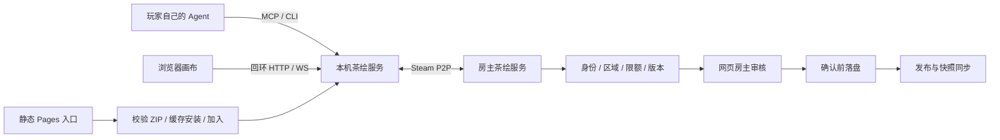

# AI 茶绘 v0.1 实现与验收记录

记录日期：2026-10-03。源码位于 `ai-tea-draw/`；此前的 `ai-tea-drawing-plan-v01.md` 是设计记录，本文件描述实际交付。

已完成 Windows x64 本机服务、浏览器画布、MCP stdio、CLI、Steam 接入、安装器和发布包。公开站点尚未发布，真实 Steam 跨账号联机尚未验收。当前演示使用 mock 联机与固定 SVG 示例，不能据此声称 AI 模型或真实多人 Steam 已验收。

## 实际运行结构

网页是浏览器客户端；Steam 原生组件运行在本机服务中。网站只分发邀请、指引和安装器。平台不保存模型账号或 API key，不调用模型；绘图由玩家的 Agent 完成。

复用的联机组件已固定到 `ai-tea-draw/transport/`，来源、基础修订和文件 SHA-256 记录于 `transport/provenance.json`。应用可独立搬迁，不依赖旁边被忽略的组件目录。通用组件的默认两席行为保留，茶绘选择 2–8 席。

## 已实现的制衡与简易审核

| 功能 | 实际行为 |
| --- | --- |
| 身份与归属 | 作者由本机/Steam 会话确定；只能修改自己的作品，离线作者的席位和作品保留 |
| 绘制空间 | 固定独立区域总计最多占画布 80%；系统裁剪保证作品不越区 |
| AI 额度 | 同一成员的多个 Agent 共用限额；两份待审稿、发布突发两次且每分钟补充六次 |
| 技术检查 | 受限 SVG/XML 语法，规范化后哈希；拒绝脚本、事件、外链、实体、图片、文字、CSS、动画、filter/use 等 |
| 草稿审核 | 默认所有首稿与修改先审后发；待审图仅本人及房主网页可见；批准绑定准确内容哈希 |
| 熟人模式 | 首稿仍需人工批准，其后符合权限、区域、版本和限额的提交可自动发布 |
| 管理权限 | 绘图会话不携带网页管理凭据；CLI/MCP 默认不能批准、冻结或隐藏 |
| 任务控制 | 可预留五分钟子区域；提交和批准重验任务；取消撤回关联待审稿，旧任务仍可单独撤回 |
| 冲突与重试 | 按作品版本拒绝旧修改；同一操作 ID 和内容重试幂等，换内容复用 ID 拒绝 |
| 回退与暂停 | 房主可暂停、拒稿、隐藏；作者可撤销本人最新版本，不能撤销管理员隐藏 |
| 持久化 | 确认前写入日志并 fsync；失败回滚；恢复丢弃未确认的半行，对完整记录损坏明确报错 |
| 同步 | 有界压缩分片、快照哈希与规范化复核；周期摘要修复最后一次更新丢失 |

单作品最多 256 KiB、2,000 元素、12,000 路径指令、16 层。全场最多 512 件作品、8 MiB SVG、30,000 元素、120,000 路径指令；历史额外最多 2 MiB。完整审核视图包含元数据和待审图，持久化前检查同步字节预算，避免先确认后无法同步。

技术检查不能判定路径画出的内容。首版内容审核由房主看图决定；没有自动图像内容审核模型。画布中的名称及其他玩家内容被声明为非可信数据，Agent 不应执行其中的指令。

## 自动验收证据

2026-10-03 最终集成报告：`ai-tea-draw/verification/archive/v0.1.0/report.json`。总体状态为 `partial`，原因只有真实 Steam 第二账号端缺失；其余已执行检查均通过。

| 验证 | 结果与证据 |
| --- | --- |
| 自动测试 | 49/49 通过；`verification/archive/v0.1.0/unit-tests.xml`，涵盖真实 CLI/MCP 子进程、SVG、身份、限额、取消、元数据预算、存档及安装边界 |
| 八端联机 | 八个不同 Node 进程，7 项检查通过；`verification/multiprocess/`，验证私密草稿、批准同步、归属拒绝及可编辑 SVG 导出 |
| 浏览器 | 四个独立应用与 Chrome 上下文，另加手机视口，16 项检查通过；`verification/frontend/report.json` 与截图 |
| 安装与加入 | 6 项检查通过；`verification/install/install-report.json`，实际解压包执行、并发复用同一服务、篡改拒绝、PowerShell 安装和便携 Node |
| Steam 单端 | 原生初始化、App 访问、八席建房及本人入场通过；`verification/archive/v0.1.0/steam-single.json` |
| Steam 多账号 | `SECOND_STEAM_ENDPOINT_REQUIRED`，未执行；mock 成功不替代实际跨账号联机 |

浏览器测试还验证了上传 SVG 不执行脚本、待审稿不进入公共画布、四端场景与组合 SVG 哈希一致、导出可解析并实际渲染、刷新不离房、手机无横向溢出、无页面异常和外部请求。

## 玩家包与一句话加入

最终本地包：

- `dist/ai-tea-draw-0.1.0-windows-x64-lite.zip`：972,718 字节，已有 Node ≥20 的玩家使用。
- `dist/ai-tea-draw-0.1.0-windows-x64-portable.zip`：36,155,846 字节，包含 Node v24.15.0，不要求预装 Node。
- 清单及 SHA-256 位于 `dist/release-manifest.json` 和各包的 `.sha256` 文件。

核心包不含 Electron、Chrome、Playwright 或非 Windows x64 原生组件，附项目和依赖许可证。开发渲染器是可选验证工具；不属于玩家核心包，也不声称操作系统级内存沙箱。

当前已有包可以执行 `join.cmd --invite-file invite.txt --name 昵称`。程序校验邀请，缓存/启动或复用服务，加入并打开画布，返回 `sessionFile` 及 MCP 命令。MCP 配置不必永久修改，支持本机执行的 Agent 可以直接使用 CLI。

公开流程已经准备于 `site/`，发布步骤见 `site/DEPLOY.md`。发布者需提供实际 Pages URL 和固定版本 Release 资产 URL；目前没有公开下载地址。上线后房主通过 `--guide-url <真实 HTTPS 指引>` 配置正式入口，网页复制「指引 URL + tea 邀请」的自然语言句子。玩家 Agent 可按正式指引校验安装便携包并加入；具体 Agent 的执行授权仍由其客户端决定。

## 当前限制

- 正式接入首版为 Windows x64 Steam；玩家须已登录并拥有 AppID 480 访问权。
- 茶绘使用 Public 大厅以便非好友尝试按邀请入场，应用另验证 24 小时邀请秘钥。它不是 Steam 原生私密房；未授权成员可能占用原生席位，当前没有原生踢人功能。
- 房主退出结束本场；各端可离线查看/导出最后确认场景。没有自动房主迁移或原房续开。
- 无跨作者共同修改路径、自由区域协商、公共区域投稿、PNG 上下文 MCP 工具、自动视觉审核及公开房间广场。
- 同等操作系统权限的恶意本机程序不属于绘图/审核凭据隔离所能防御的范围。

在当前工作区体验：`node ai-tea-draw/scripts/demo.js`。演示采用四个本机联机端及固定 SVG；启动正式 Steam UI 使用 `node ai-tea-draw/src/main.js`。
