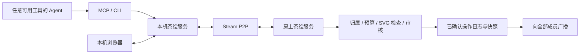

# AI 茶绘实施规划 v01

日期：2026-10-03（Asia/Shanghai）。状态：设计方案，尚未实施。

用户已确定：复用现有 Steam 联机组件；多人带自己的 AI 画 SVG；开放 MCP + CLI 接入，模型和账号由参与者自行管理。茶绘不内置模型 API 配置，不要求使用某一家 Agent。

## 1. 产品定义与首版范围

把产品做成「人指挥自己的 Agent，在同一张公共画布上共同创作」的房间。人决定画什么、在哪里画、是否允许 AI 连续发布；Agent 读取局部画面和房规，制作 SVG 作品块并提交。系统管理归属、空间、预算、审核、同步和撤销。

首版目标是 Windows x64、最多 8 个参与席位（含房主），先完成 4 人验证再升到 8 人。旁观者也占实际联机席位，不宣称无限旁观。第一版保留固定房主；房主关闭后结束会话，大家保留已确认作品快照。后来者可加入并同步现有画布。

默认画布 4096×2304，可缩放、平移。提供成员列表、画布、我的 AI 任务、草稿预览、审核抽屉、贡献历史。主题、背景色、参考色板由房主设置。聊天只提供受限长度的纯文本；MVP 可先只做成员状态与作品留言。

一个可演示场景：房主定题「深海夜市」，四位参与者分别让自己的 Agent 画鲸鱼摊主、珊瑚建筑、灯笼和小鱼顾客；各自预览，通过房间规则后上画布；点击作品能看到作者、版本并单独撤回，最后导出一张可编辑 SVG。

首版不包含无限画布、动画 SVG、任意 HTML/JavaScript、位图嵌入、公开房间广场、跨端自动接管房主、多人同时编辑同一条路径、内置大模型聊天和绘图服务。

## 2. 现有组件的复用与缺口

本轮源码核对结果：

| 现有能力 | 处理方式 |
| --- | --- |
| Steam 身份、大厅、可靠 P2P、项目隔离 | 复用 `SteamTransport` 和协议封装 |
| 本机 HTTP/WS 桥接、会话 token、来源检查 | 复用安全边界，新增应用层路由 |
| Steam 与 mock 房间都固定 2 人 | 新增经过范围校验的 `maxMembers`，默认仍为 2；茶绘显式传 8 |
| 客机只接收房主消息 | 保留，由房主验证并转发已确认操作 |
| 每桥接只有一个浏览器 WS 控制连接 | 保留单 UI；MCP/CLI 走独立本机应用 API，不抢同一个连接 |
| 单包上限 768 KiB | 保留传输上限，作品提交另设更小限额；大快照分块 |
| 房主退出关闭会话 | 首版保留，补齐保存、最后确认版本和恢复新房间 |
| 双浏览器、双进程自动测试框架 | 复用报告与调度思路，新增茶绘断言和 N 端运行器 |

关键源码：`src/runtime/steam-transport.js:36`、`src/mock-hub.js:43`、`src/runtime/bridge.js:45`、`src/protocol.js:2`，均位于 `steam-spacewar-multiplayer-skill/`。

Steam 官方大厅 API 支持指定人数，但大厅容量不等于本项目的画布承载能力。8 人是待验收的产品目标，不是现有实现已经支持的结果。[Steam 大厅文档](https://partner.steamgames.com/doc/features/multiplayer/matchmaking)

应用采用新目录/独立项目，例如 `ai-tea-draw/`，不耦合原游戏 `G.Game`、`G.Net`、`coop.js`。通用人数与应用接口扩展回到组件源码，并固定组件版本；不能只修改忽略目录里的运行时副本。

## 3. 架构：每台一个本机服务，房主统一落图



房间权威状态放在房主 Node 服务中，浏览器只做展示和操作界面。浏览器刷新不会抹掉房间状态；Node 进程退出才终止主持。每个进程只创建一套原生 Steam 读包器，不能让 UI、MCP 和 CLI 分别初始化 Steam 或争抢原生消息队列。

新增 `SessionService` 拥有传输、应用消息分发和持久化；UI、MCP、CLI 都调用应用命令。现有桥接是原始传输接口，不能直接把 `send(to, arbitraryData)` 当成 Agent 的公开绘图 API。

现有桥接会在浏览器 WS 关闭时离开房间。茶绘需要单独的服务生命周期：UI 断开只取消订阅，不触发 SessionService 离房；原游戏仍保留原有行为。复用接口必须把这项差异明确做成应用策略。

主机也通过相同的绘图权限、预算和规范化流程发布。管理权限是另外一组可记录的操作。固定房主仍是信任边界：官方程序能约束普通参与者和 Agent，无法保证抵抗任意修改程序的恶意房主。

不需要自建公网业务服务器，但每人仍需 Steam、本机运行环境和自己的 AI。SpaceWar 是 Steamworks 示例环境；不能把原型的接入方式描述成未来正式商业服务的永久免费承诺。[Steam SpaceWar 官方说明](https://partner.steamgames.com/doc/sdk/api/example)

## 4. MCP 与 CLI：共用一套应用契约

MCP 适合支持工具协议的 Agent；CLI 适合可以运行命令、读写文件的 Agent。二者调用同一个 schema 和命令处理器，不分别实现绘图逻辑。兼容范围表述为「支持 MCP 或本地命令执行的 Agent」，具体客户端仍需契约测试，不能保证所有封闭产品都能安装工具。

MCP 的工具可声明输入和输出结构，适合暴露受限画布操作。[MCP 工具规范](https://modelcontextprotocol.io/specification/latest/server/tools)

建议工具：

| 工具 | 用途 |
| --- | --- |
| `room_get_rules` | 获取主题、权限、审核方式、剩余预算与规则版本 |
| `canvas_get_context` | 返回指定区域 PNG、可编辑对象摘要、对象版本及归属 |
| `region_reserve` | 为当前任务申请短期绘制区域 |
| `draft_validate` | 检查 SVG，返回错误位置、规范化结果与预算预估 |
| `draft_preview` | 渲染局部及全图合成预览，返回内容哈希 |
| `proposal_submit` | 提交候选作品；是否发布由权限与审核状态决定 |
| `proposal_get_status` | 查询 accepted / pending / rejected / stale |
| `contribution_revert` | 撤销有权限的贡献，保留历史，不覆盖他人后续操作 |
| `job_cancel` | 停止本应用接收任务后续结果并释放临时预留 |

以下仅为拟定接口，不是已经存在的命令：

```text
tea room rules --json
tea canvas context --region my-region --out context.json
tea draft validate --file ./draft.svg --json
tea draft preview --file ./draft.svg --region my-region --out preview.png
tea proposal submit --file ./draft.svg --region my-region --base-revision 17 --json
tea proposal status --id <proposal-id> --json
```

CLI 用文件/stdin 提交 SVG，避免把长 XML 放在命令行参数里。结构化结果包括 `status`、`proposalId`、`contentHash`、`errors`、`remainingBudget`、`retryAfterMs`。提案 pending 必须明确显示，不能让 Agent 误认为已经发布。幂等键由调用方提供；同一个键、相同内容返回同一结果，不同内容则报冲突。

本机 API 只绑定 loopback，验证 Host/Origin 和短期凭据。MCP 优先本机 stdio；CLI 通过受限本机凭据调用。Agent 的凭据限制到本人、当前房间、指定任务和区域，不提供踢人、审批、修改房规、读取任意文件、执行任意命令的能力。

CLI 的 `--file` 由调用端读取后上传内容；远端消息和服务端工具不能借一个文件名去读取主机磁盘。

审核者权限不随绘图凭据发给 Agent。Steam 身份由传输层确定，不能相信上传 JSON 中的 `authorId`、`role`、`approved`。多 Agent 进程共享同一参与者的预算。

原始提示词、API key 和推理过程不通过房间广播；共享内容限于作品、作者标识、公开任务摘要、状态和必要的审计记录。画布及别人留言属于非可信任务数据，不能变成 Agent 的系统指令；输出上下文明确分开房规与用户内容。

## 5. 画布与同步数据模型

核心对象建议：

- `Room`：房间实例 epoch、主持人、成员、画布尺寸、规则版本。
- `Region`：区域形状、归属、占用额度、临时 lease。
- `Contribution`：一块作品、作者、放置位置、规范化 SVG AST、内容哈希、对象版本。
- `Proposal`：候选操作、引用版本、检查结果、审核决定、过期时间。
- `Commit`：房主序号、操作者、操作摘要、前后版本、时间、哈希。

首版以一个可独立撤销的作品组为最小公共编辑单元。AI 可以用多条 path 画一只鲸鱼，但发布时原子提交一个完整作品块；不能出现审核中只露出半张图的状态。修改时替换自己的作品块版本，首版不对任意 XML 文本做多人合并。

协议步骤：

1. 加入时交换应用版本、schema、房间 epoch、规则版本和 capabilities。
2. 新成员获取固定序号 S 的快照及哈希，再顺序应用 S 之后的操作。
3. 客机提交含操作 ID、目标对象版本、规范化候选哈希和区域的提案。
4. 房主从 Steam 发送者推导身份，重新校验成员资格、归属、额度、锁和内容。
5. 审核完成后在同一次串行提交中再校验权限、目标版本、预留和规则版本；失效则标记 stale，不能强行覆盖。
6. 先持久化规范化资产与操作记录，再返回确认和广播。客户端只把确认版本写入公共状态。
7. 客户端检测序号缺口或状态哈希不一致，请求补日志；日志过期则重新获取快照。

为发现「最后一次广播丢了、后续又无人绘图」的情况，增加定期的最新确认序号/哈希通告和确认超时，不能只等待下一次操作暴露缺口。

以对象版本判定编辑冲突，而非任何人修改画布都让全局旧版本提案失败。全局 `roomRevision` 用于顺序和同步；作品 `objectRevision` 用于覆盖保护；涉及内容合成审核时，还要记录审核所依据的区域版本。

同时改自己的不同作品可正常提交；同时改同一作品时先到的合法提交成功，另一个返回冲突。合作改图需要所有者授予明确的对象编辑权和短期锁。首版无需引入 CRDT。

完整快照按约 48 KiB 的净负载切块，计入封装后的实际字节；限制分块数量、总大小、在途数量、重组时限，校验整包哈希。只解析完整且通过校验的快照。绘图提案按人公平排队，控制消息优先；光标、正在思考等状态可以合并丢弃，不能挤占正式提交。

默认只广播通过检查且被批准发布的规范化作品。草稿保留本地；待审内容仅作者和审核者可见，普通参与者只收到状态。审核界面也只显示安全渲染结果。

## 6. 如何制衡 AI：空间、频率、权限与复杂度

提示词用来指导风格，硬限制由房主执行。客户端自行报出的面积、作者、渲染时间都不能作为放行依据。

| 问题 | 机制 |
| --- | --- |
| 快模型占满画布 | 每人保证一份基础空间；新区域按人排队，面积配额按人而非 Agent 数分配 |
| 多开 Agent 刷量 | 同一 Steam 成员的所有进程共享额度、队列和任务上限 |
| 越界遮盖他人 | 房主控制作品容器与裁剪范围；导入内容不能修改外层裁剪、图层顺序或他人的对象 |
| 涂一整块颜色遮住别人的画 | 默认区域不重叠；共享区域的新遮挡/大覆盖进入审核，不能只靠图层归属 |
| AI 无限修修补补 | 单任务最大回合数、发布速率、待审数量和重试退避；连续失败进入冷却 |
| 删除重建绕过限制 | 统计滚动时间窗内累计新增/修改工作量，不因删除立即返还提交额度 |
| SVG 极度复杂卡浏览器 | 字节、节点、路径指令、嵌套深度、场景累计预算和隔离渲染超时共同限制 |
| 审核前合法、批准时抢了别人区域 | 审核只批准确定哈希；提交前再次校验目标版本和额度预留 |
| AI 擅自全局重绘 | 绘图 token 只能操作自己的作品与获授权区域；无全画布替换权限 |
| 连续锁着区域不画 | 临时预留有期限和续期上限，有等待者时不能无限续租 |

建议起始参数，均为待压测调优的设计值：

| 参数 | 起始值 |
| --- | --- |
| 人数 | 先 4，目标 8（含房主） |
| 画布 | 4096×2304 |
| 每人并行公共绘图任务 | 1 个；多个 Agent 共享 |
| 每人待审提案 | 最多 2 个 |
| 正式发布速率 | 每分钟 6 次、短时突发 2 次 |
| 候选 SVG | 每份不超过 256 KiB |
| 单作品复杂度 | 2,000 个元素、12,000 条路径指令、16 层嵌套以内 |
| 活跃整图预算 | 30,000 个元素且规范化数据不超过 8 MiB；任一超限就拒绝新增 |
| 临时区域预留 | 5 分钟，必要时有界续期；长期作品不会因预留过期消失 |
| 自动修复回合 | 每任务默认最多 3 次；额度耗尽给出可操作错误，不无限循环 |

空间分配建议保留 20% 给公共构图，其余 80% 按房间席位提供基本配额，8 席时每人有 10%。这是额度池，不强制画成八宫格：人可以选择不同形状和位置的空白区域，后续扩展由房间明确授予。区域领取必须原子处理，不能两个人同时成功占用同一块。未被授予的公共空间不能靠先发包抢占。

永久作品归属与短期任务预留是两件事。断开连接会释放任务锁，但保留作品与作者。隐藏、透明和移出视口的对象仍计入存储与复杂度预算。系统计算变换后的范围，限制描边宽度，并由外部容器执行最终裁剪；不能只相信 SVG 自报的 viewBox。

房主作为创作者遵守相同额度。放宽某人的额度、冻结作品、清屏等管理操作留下记录。审美判断由人决定，系统不使用「画得不够好」作为拒绝理由；调色板、透明背景、线宽等可作为清楚可见的房间规范。

外部 Agent 的 token 消耗和真实计算时间不受茶绘控制，因此不能用它们作可验证的公平配额。本应用可以停止接收结果、撤销绘图凭据；是否能停止外部模型任务取决于该 Agent 自身能力。

资源限制同时覆盖整个场景的路径指令总数，以及每个连接的上传速率、解析前请求数、排队字节和历史资产体积，防止大量被拒绝提案本身耗尽资源。具体全局路径预算在首轮渲染基准后确定。

## 7. SVG 安全与确定性渲染

输入 SVG 先做字节预检，再用禁用 DTD、外部实体和网络解析的 XML 解析器构建树；按允许列表转换成自己的 AST，再由程序生成规范化 SVG。禁止直接把原始字符串写入界面 `innerHTML`，也不能只用正则删除 script。

首版允许基础几何、path、group、有限 transform、纯色 fill/stroke，以及经过 ID 重写的本地线性/径向渐变。文字通过受控文本工具和统一字体生成，限制长度与布局。用户不能提交任意 style/CSS、script、事件属性、foreignObject、image、外链、data URI、use、动画、filter 或用户自定义 mask；裁剪由系统生成。所有本地引用必须指向同一作品中的已检查定义，引用不允许环和无限展开。

数值必须有限，坐标、变换、描边、渐变数量都有限额。拒绝多根文档、异常命名空间、实体膨胀和递归结构。超出子集返回具体错误，避免静默删除关键画面导致「预览与实际提交不同」。

渲染在无网络、无文件访问的受限子进程中执行，带内存和时间上限；单份作品渲染失败不能卡死房间。渲染器版本和字体固定，以同一份规范化数据生成预览和公开内容。客户端仍做基础 schema 检查，不把远端数据当可执行 UI。

MDN 区分了 SVG 的图片上下文与文档上下文：图片上下文通常禁脚本与外部资源，但这些限制并不自动适用于内联/文档嵌入。因此「它是 SVG」不能成为安全理由，必须使用上述允许列表与隔离措施。[MDN：SVG as an image](https://developer.mozilla.org/en-US/docs/Web/SVG/Guides/SVG_as_an_image)

## 8. 简易审核：结构检查与画面内容分开

最小可交付审核不依赖另一家付费模型：自动检查技术规则，作者预览，房主/协管在待审列表看缩略图与修改差异，点击通过、退回或隐藏。

状态至少分别记录：结构检查结果、作者确认结果、房间内容审核结果。不能把「XML 合法」「作者已确认」或「没有命中关键词」标成内容审核通过。

建议提供两种清楚标注的房间模式：

| 模式 | 发布规则 | 适用范围 |
| --- | --- | --- |
| 先审后发 | 每个候选通过结构检查后，等待房主/协管批准；批准前不发给普通成员 | 新认识的参与者，首版验收默认模式 |
| 熟人自由绘 | 新成员首稿审核；之后在授权区域内、通过技术规则和本人发布策略即可上图；支持举报后隐藏 | 邀请制熟人房；明确没有逐稿内容预审 |

作者可选「每份作品预览确认」或「本轮任务在限定区域与额度内自动提交」。授权一次作用于这轮明确任务，避免每个 path 弹窗；对超范围操作和房间待审决定仍不能越权。房主审核者不必判断模型技术过程，只看最终候选及其合成结果。

审核抽屉显示：作者、修改前后切换、作品局部图、在整图中的位置、是否新增文字、覆盖范围、规则命中原因、通过/退回/隐藏操作。退回只需要一句理由，Agent 收到固定错误码与可读说明后修正。

举报只先隐藏举报者本机的内容并通知审核者，不能凭一票让全房删除；房主可全房隐藏、冻结作者或撤销绘图权。被限制者即使仍能发送 Steam 数据包，也会在应用层被拒绝。不能把前端禁用按钮当成封禁。

首版保证的是应用内撤销绘图权。原生 Steam 强制移除成员及释放大厅席位的可用接口需另行验证；不能把应用层封禁说成已经完成原生踢人。

规则以少量、可理解条目为主：不涂改他人、不暴露私人信息、不针对参与者辱骂骚扰、不发布房规禁止的色情/极端暴力内容、不刷屏。关键词用于文字提示和排队，不能识别 path 画出的图案，更不能独自承担图像审核。

可选第二阶段接一个房主指定的内容审核器：只把安全渲染的作品局部与合成上下文、必要文字送给它，返回 allow / review / reject、理由和不确定性；没有管理工具调用权。画里的文字属于被审内容，不能改变审核器规则。房间明确告知作品是否会发往第三方服务。

机器审核必须支持 abstain/超时并保留待审，不能在失败时自动放行。应检查作品与受影响合成区域，避免把单个无害片段逐步拼成不当图案。审核结论绑定内容、放置位置、相关画布版本和房规版本；修改任一项都可能需要重审。没有内容模型且无人处理时，先审后发模式就继续 pending。

简易审核不保证杜绝所有违规图案。V1 的交付标准是规则能执行、预审不泄露、可以追踪和撤回；开放公共广场需要另外评估。

## 9. 人机协作体验

推荐常用循环：人选择区域并下达主题 → Agent 读取规则和局部上下文 → 生成 SVG → 本地校验并预览 → 有界自修 → 提案 → 审核/授权发布 → 公共画布更新。

让 Agent 每次拿到一张全图低清缩略图、一张工作区域清晰图、附近对象摘要和预算即可，避免不断喂完整 SVG。别人作品默认作为只读视觉上下文；需要续画时，由作者授予指定对象编辑权。

公共状态显示「构思中 / 生成中 / 待审 / 已落图」，不持续广播未完成 XML。后续可选择把通过检查的阶段稿逐块发布，形成绘制过程；不得用播放顺序绕过审核。

人的基本操作包含移动自己的作品、缩放、隐藏、复制为自己的新作品、撤销和导出。复制后的作品计入新作者的预算并保留来源说明。跨作者协作和共享背景要有明确授权。

## 10. 保存、撤销与导出

房主使用追加日志和周期快照。提交确认表示该版本已落盘；恢复时只重放完整记录，丢弃未完成尾部。客户端保留最近的确认快照与自身草稿，不将未获确认的乐观画面当成公共成果。

单作品撤销通过逆操作或恢复指定对象版本完成。如果别人获得授权后继续修改了它，不能直接把旧版本覆盖回去；返回冲突，选择新建恢复副本或走协作确认。房主整体回滚会创建新的房间修订记录，而不是偷偷改写历史。

退出和断线时明确显示最后确认版本与未提交草稿。房主进程关闭后首版停止会话，保留离线阅读/导出；从保存文件开新房属于新 epoch，不宣称已经实现迁移。

导出两份：可直接查看的安全 SVG，以及包含分层、归属、版本和房规的茶绘工程。PNG 可作分享预览。导出内容也只来自规范化数据，不回填原始不安全标签。日志、待审资产、缓存都有大小上限与保留策略；被拒绝原文默认不永久保存。

## 11. 自动验收

沿用前一项目要求：软件验证由脚本完成。产品有「人点审核」功能，不等于测试需要真人审核；自动化模拟审核者按通过/退回，并断言可见性和状态。

| 测试层 | 必须证明的结果 |
| --- | --- |
| MCP/CLI 契约 | 相同操作产生相同规范化结果；错误可解析；任务取消撤销凭据；工具不越权 |
| SVG 防护 | 恶意 script/事件/外链/实体/use/滤镜/超深结构被拒；无外部请求和脚本执行；恶意样本不影响后续合法作品 |
| 公平与权限 | 越界、删别人、改图层、伪造作者/审批、多个 Agent 套额度、删除重建刷量都被阻止 |
| 并发一致性 | 4/8 个模拟端同时提交；重复/乱序/断线重试后每端的规范化文档哈希一致 |
| 审核 | 待审图普通端收不到；批准哈希不可替换；权限/版本变化后不会提交过时内容；审核器失败仍待审 |
| 撤销与存档 | 撤销只影响目标贡献；恢复不丢已确认提交；日志尾部损坏可安全恢复 |
| 资源压力 | 全图预算、复杂 path、刷提案、慢客户端不会无限堆内存或让其他成员饿死 |
| 原游戏回归 | 扩展通用组件后仍默认双人，原有 22 项逻辑测试与本地游戏验证不被破坏 |
| 真 Steam | 不同机器、不同账号运行预装程序，实际发布/审批/撤销/补同步成功且文档哈希一致 |

至少提供：两套独立 Agent 客户端的实际 MCP/CLI 接入演练；无法控制模型是否画得美的测试只检查协议与流程，不假称审美验收。

示例验收任务为「A 画鲸鱼、B 画灯笼、C 画建筑、D 加文字」，使用可复现 SVG 测试夹具跑完整流程；另做真实 Agent 产出探索，二者分开记录。

结果输出 JSON、JUnit、截图及最终 SVG；报告不包含房间凭据。退出码继续采用 0 通过、1 失败、2 环境阻塞。8 个 mock 实例不是 8 个真实 Steam 账号的证据：真实只测到 2 人就只报告 2 人，4/8 人支持声明等待对应规模验证。跨网链路缺少环境时不阻止其余自动测试，也不把结果改成通过。

性能门槛在最早的多人里程碑用记录了硬件和场景的基准确定，至少测发布确认耗时、审批后同步耗时、首屏快照耗时、主机上行量、内存峰值与画布帧时间。审美生成时间、排队时间、审核时间、网络同步时间单独记，避免把模型慢算作网络慢。

## 12. 实施顺序与阶段交付

| 阶段 | 交付 | 放行条件 |
| --- | --- | --- |
| M0：本地绘图契约 | 单人画布、受限 SVG AST、校验/预览、CLI、保存/导出 | Agent 用 CLI 交付一块安全可编辑作品；恶意输入被自动挡住 |
| M1：多人文档 | 组件人数参数、房主 SessionService、4 端 mock、后来加入、操作日志与撤销 | 并发提交后各端文档一致，重连补同步与归属隔离通过 |
| M2：开放 Agent 接入 | MCP、CLI 同一处理器、作用域凭据、区域预留、额度、任务状态 | 至少两套独立客户端跑完，多个 Agent 不能绕过按人预算 |
| M3：简易审核 | 待审队列、两种房间模式、通过/退回/隐藏/冻结、差异预览 | 原子批准、待审隔离、版本变化重审全自动通过 |
| M4：实际 Steam 与分发 | 双机再到 4/8 机自动验证、便携包、干净解压检查、接入说明 | 按真实完成规模标注支持人数；默认双人游戏组件回归通过 |

第一个产品里程碑应是：四个人用各自工具控制各自 Agent，在同一房间画出四块可管理作品，越权会被拒，房主能审核，所有人能导出相同结果。先证明这个闭环，再考虑连续绘图动画、复杂协作合并和更大房间。

目前只有本规划与对现有源码的核对；茶绘界面、接口、审核和多人扩展均未实现。

## 13. 轻量客户端与纯 Web 路线评估

2026-10-03 补充。用户要求评估尽量小的客户端或直接 Web 客户端。以下为建议与包体测量，不代表已完成精简或确定改用另一种传输。

### 13.1 当前包体的真实构成

读取现有 `dist/yuanqi-steam-windows-x64.zip` 的 ZIP 条目，获得下表。单位 MB 为十进制；压缩大小不包含 ZIP 目录及条目头开销。

| 内容 | 解压后 MB | ZIP 中压缩 MB |
| --- | ---: | ---: |
| Node 运行时 | 91.69 | 35.25 |
| Playwright 自动验证依赖 | 13.45 | 3.17 |
| Linux/macOS Steam 二进制 | 6.41 | 2.32 |
| 其余 Steam 模块文件 | 2.46 | 0.84 |
| 其余组件文件 | 2.97 | 0.61 |
| 游戏前端与声明 | 0.57 | 0.17 |
| WebSocket 依赖 | 0.15 | 0.04 |

现有 ZIP 总计 42,460,115 字节。按现有条目算术扣除 Playwright 与非 Windows 二进制后约 36.98 MB；再扣除 Node 后约 1.73 MB。这些是体积估算，不是重新组装并通过运行验证的发布包。缺 Node 的版本必须依赖用户机器上已验证兼容的 Node，不能标成完全自包含。

包体瓶颈主要是通用运行时。前端已经较小，只压缩 HTML/JS 无法解决 35 MB 的压缩运行时成本。自动验证仍需保留，但可独立为同版本验证包，不必发给每一个普通参与者；发布流水线对精简包做完整自动检查。

### 13.2 三条实际路线

| 路线 | 用户体验 | Steam 复用 | 主要代价 |
| --- | --- | --- | --- |
| Web UI + 精简 Node 桥接 | 启动本机服务，自动打开默认浏览器；有 Node 者用轻量包 | 直接复用现有实现 | 自包含版仍需 Node 运行时 |
| Web UI + 原生小桥接 | 下载小程序，双击后浏览器使用；同一程序提供 MCP/CLI | 复用协议与设计，原生封装需迁移并回归 | 增加 Rust/C++ 等原生实现与维护成本 |
| 纯 Web + Web 联机后端 | 打开网址即可参与，浏览器不安装茶绘程序 | 无法直接运行当前原生 Steam 传输 | 需要在线房间服务或 WebRTC 信令/中继，额外部署运营 |

推荐当前默认：界面全部做 Web，继续 Steam 的原型阶段复用 Node 桥接；将精简版与完整运行时版分开。若自包含安装包的小体积是发布硬指标，在做完整产品前先验证原生桥接原型，不能等应用层全部绑定 Node 后才开始迁移。

拟定产品体积预算：网页首屏压缩资源不超过 1 MB（作品数据不计入首屏壳）；原生小桥接的完整下载包争取不超过 15 MB，必须包含必要 Steam 库、校验/渲染组件与字体后实测。这是设计目标，没有编译产物证明可达。

原生路线可以统一为一个 `tea.exe` 的不同子命令：启动本机服务、作为 stdio MCP 入口、作为 CLI 客户端。只有常驻服务初始化 Steam，其他入口连接它；不能每次 CLI 调用重新初始化原生会话。

不随包携带浏览器。默认使用系统已有浏览器打开由本机服务提供的同源页面，前端资源可内嵌保证离线可用。暂不增加桌面窗口框架。若以后确实需要独立窗口，可评估 Tauri；它复用系统 WebView，但 Windows 上仍有 WebView2 环境依赖，不能只看安装器文件大小。[Tauri WebView 说明](https://v2.tauri.app/reference/webview-versions/)

### 13.3 纯 Web 的边界

普通网页不能直接加载当前 `steamworks.js` 原生 `.node` 模块和 Steam 动态库。本项目 Steam 连接依赖本地 SDK 初始化及回调处理；网页化 UI 不等于浏览器获得同一能力。[Steamworks API 概览](https://partner.steamgames.com/doc/sdk/api)

纯 Web 联机可选 HTTPS/WebSocket 房间服务，统一负责操作顺序、审核、存档和广播；对于低频 SVG 提交，这条路线较直接。也可使用 WebRTC DataChannel，但仍需建立连接的信令机制，跨网直连失败时还要 TURN 中继；不能承诺任意网络下完全无服务端成本。[WebRTC TURN 说明](https://webrtc.org/getting-started/turn-server)

纯 Web 与开放 Agent 接入兼容：网页和 Agent 连接同一个房间后端，Agent 通过远程 MCP HTTP 或 CLI/HTTP API 提交，使用限定到本人和房间的凭据。浏览器不负责启动本地 stdio Agent，也不读取用户电脑任意文件。支持远程 MCP 的客户端可不安装茶绘本机服务；仅支持本地 stdio 的客户端需要小型适配器。[MCP 传输说明](https://modelcontextprotocol.io/specification/latest/basic/transports)

同时支持 Steam 成员与纯 Web 成员需要额外的网关/传输适配，并映射两种身份；Web 成员没有自动获得 Steam 身份。首版不把这种混合组网当成小改动。

前端与文档操作协议从一开始独立于 Steam。可用 `RoomTransport` 抽象传输，但额度、规范化、审批与提交逻辑仍在可信服务端执行，不移到普通参与者浏览器。这样后续改成 WebSocket 云端时能复用画布和 MCP/CLI 契约。

### 13.4 发布验收增加的检查

分别报告压缩下载大小、解压体积、首次安装额外下载、所需系统运行时、常驻内存与启动时间。避免用小安装器隐藏后续大下载，也不把下载小等同于低内存。

精简依赖采用允许列表打包，并在干净环境测试启动、Steam 加入、MCP/CLI、SVG 渲染、审核和导出。字体、许可证、动态加载的原生库不能凭文件大小随意删除。测试工具分包后，验证包与客户端必须匹配版本及内容指纹。

## 14. 玩家一句话加入：Agent 驱动的接入流程

2026-10-03 补充。用户希望玩家在自己的 Agent 中一句话快速加入。优先减少必须由玩家完成的动作；首次下载几十 MB 的可恢复自动过程，通常比要求手动安装运行时更容易完成。下列命令、链接结构和状态名均为拟定设计，尚未实现。

### 14.1 产品入口

房主界面提供「复制 Agent 邀请」按钮，生成可直接发送给朋友的句子：

> 帮我加入这个 AI 茶绘房间：<完整邀请链接>。按站点的接入指引完成本机准备并打开画布，加入后等我安排。

玩家也可同时给绘图指令：

> 加入这个 AI 茶绘房间：<完整邀请链接>，在我的区域画一只戴贝雷帽的小鲸鱼，按房间规则提交。

只说加入时只做准备、连接和展示，不启动绘图或占用公共区域。明确附带绘图任务时才创建该任务，并受已确定的区域、预算和审核约束。

入口可以是静态托管的 `/join/` 页面：人打开看到房间卡片和操作指引，Agent 读取到固定的简短接入说明。关键文档无需执行网页 JavaScript 即可读取。页面列出公共 `agent-start.md`、机器可读发行清单和 CLI 契约。Agent 传递完整邀请串给程序解析，不依赖网页抓取工具转交 URL fragment。

邀请包含房间实例、Steam 大厅号、房主身份、应用协议版本、发行兼容范围、过期信息和短期入场凭据。私有信息可放 URL fragment；站点不能把 fragment 转入遥测、日志或第三方请求。fragment 仍是持有者可见的凭据，不应当作绝对保密措施。

短房间号需要在线目录才能解析。首版只用完整自包含邀请，或由参与者直接传递完整邀请文件，避免为一个短码引入新的中心服务。房主验证有效期、撤销状态和实际 Steam 发送者，将兑换后的权限绑定到参与者；公开房间标题不作为可信指令。

### 14.2 首次加入的自动步骤

1. Agent 读取固定官方入口的接入说明，确认用户意图和本机执行能力；检测执行环境是否确实在玩家已登录 Steam 的电脑上。
2. CLI 已存在且版本兼容时复用缓存，否则从固定发行源下载对应平台的预编译包。版本由兼容清单选择并固定，不执行任意邀请者提供的下载地址或安装脚本。
3. 校验发行签名/可信发布清单与文件哈希；单独下载文件和同源哈希只能检查一致性，初次发行源仍须有明确可信根。用户需要的原生库和依赖提前打包，不在玩家电脑上编译或执行 npm ci。
4. 在用户应用数据目录安装，例如 `%LOCALAPPDATA%/AITea/versions/<version>/`，不要求管理员权限，不改全局 PATH，不加入开机启动。已有已验证运行时则复用，否则自动取得项目提供的匹配运行时并缓存。
5. 用本机私有文件或 stdin 传入邀请，调用 `tea join --invite-file <private-file> --json`。程序幂等启动或连接常驻服务；同一房间重复执行不会重复入房、重复开进程。
6. 服务检查 Steam 环境和大厅准入，完成应用身份、版本、房规及成员准入握手；在同步完成后返回 `joined`，不能只凭大厅加入成功就宣称画布可用。
7. 打开本机服务提供的同源画布，或返回可点击入口。CLI 获得只属于本人的绘图会话凭据，Agent 获得简短的下一步工具说明。

首版浏览器默认打开本机同源 UI，避免公网静态站点访问 loopback 的浏览器限制成为初次入房障碍。GitHub Pages 负责邀请入口、文档与发行发现；图形界面资源也随包提供离线副本。公网托管 UI 直连本机服务作为后续独立兼容项目。

后台服务由程序管理，不要求玩家保持一个命令行窗口打开。必须验证 Agent 命令退出后服务仍存活；端口自动选择，不要求玩家填写 IP。退出最后一个房间后按明确策略停止空闲服务；作者草稿继续保留。

### 14.3 CLI 优先，MCP 同协议增强

一句自然语言不能让任意 Agent 自动获得尚未注册的 MCP 工具。不同宿主的配置权限、注册机制和加载时机不同，因此不把自动配置 MCP 作为首次加入的前置步骤。

首次接入默认使用 Agent 已有的终端能力调用 CLI。CLI 返回稳定 JSON，正常结果写 stdout，诊断写 stderr；提供精简机器帮助和后续动作提示。已连接茶绘 MCP 的 Agent 直接用 MCP；用户需要长期使用时，再通过相应客户端支持的机制配置 MCP，不覆盖既有配置，也不自行重启 Agent。

MCP 的本机 stdio 和 HTTP 接入共享应用契约，具体协议与实现版本固定并做互通测试。[MCP 传输规范](https://modelcontextprotocol.io/specification/latest/basic/transports)

本机 Steam 路线要求执行环境能接触玩家的本机服务。在云端容器运行的 Agent 不能把其 localhost 当成玩家电脑；只有聊天能力的 Agent 也不能凭一句话安装程序。此类环境显示手动打开启动器的入口，或未来使用已授权的远程应用接口，不把受限客户端标成一键支持。

### 14.4 不可自动完成的环节与恢复

| 状态 | 自动处理 | 玩家需要做什么 |
| --- | --- | --- |
| `NEED_STEAM_LOGIN` | 定位问题、保留入房请求、提示继续命令 | 在 Steam 客户端自行登录；Agent 不处理账号凭据 |
| `NEED_STEAM_ACCESS` | 区分启动、AppID 访问或好友房准入失败 | 根据具体原因完成 Steam 环境或邀请/好友准备 |
| `NEED_AGENT_PERMISSION` | 清楚说明待执行的下载或本机运行 | 由 Agent 宿主的权限策略决定是否需确认，不能绕过 |
| `NEED_LOCAL_EXECUTION` | 识别远端/受限执行环境 | 使用本机 Agent 或启动本机小程序 |
| `WAITING_FOR_HOST` | 有界等待并提供取消/恢复 | 等房主上线或批准准入 |
| `INVITE_EXPIRED` | 不反复重试、保留已下载缓存 | 向房主获取新邀请 |
| `ROOM_FULL` | 显示房间满员，按房规排队 | 等席位或选择其他房间 |
| `VERSION_MISMATCH` | 能安全取得兼容版本就自动切换，不动其他房间 | 只有无法自动处理时再提示 |

Steam FriendsOnly 大厅的准入限制不会因为茶绘邀请存在而消失。首版需要验证双方的 Steam 好友/邀请条件，并将它显示成明确状态；不能假称应用邀请能绕过平台准入。

登录、平台权限提示和宿主执行确认可能需要一次人工动作；后续使用同一缓存和环境时只需再次发送邀请。程序维护可恢复的状态文件，重新执行从上次完成步骤继续，不重新下载、要求重新登录或生成重复会话。

绘图范围、发布模式和房间审核仍按用户任务及房规执行；「加入」不自动授予删除、全局管理或无限绘图权。临时 token 与完整邀请默认在日志中遮蔽，不写入公开仓库。

### 14.5 房主同样一句话

房主也可以对自己的 Agent 说「开一个四人 AI 茶绘房，主题深海夜市，先审后发，给我加入邀请」。Agent 通过同一套准备流程调用 `tea host`，确认画布和服务已就绪后返回邀请文字。

房主手动复制邀请给朋友。生成邀请不等于自动替房主发送消息。房主服务上线后，邀请可以反复复制；其有效期与撤销策略由房主控制。

### 14.6 先验证部署闭环，再扩大绘图功能

增加前置里程碑 M-1：干净 Windows 环境中，Agent 从邀请完成下载、校验、启动、Steam 就绪检查、应用握手、打开画布和一个只读查询。先用 mock 自动跑部署状态机，再用不同 Steam 账号验证真实加入。

验收矩阵包括：无 Node、有兼容/不兼容 Node、空格及中文路径、断网与下载中断、重复运行、端口占用、无 Steam 登录、好友条件不满足、过期邀请、假下载地址、错误签名、版本不兼容、常驻进程意外退出、纯远端 Agent。

成功必须同时证明：房主成员表出现该参与者、参与者拥有正确作用域、画布已同步、Agent 能读取同一房间状态、浏览器已加载或给出真实可用入口。通过不改变画布的检查即可完成入房验收，不生成未经用户要求的测试笔画。

最终对外目标：支持本机命令执行、Steam 环境就绪且执行权限允许的 Agent，可以凭一句邀请自动加入；需要玩家动作时，只提示实际缺少的那一步。此目标优先于强行承诺首次零确认、全部 Agent 通用或未实测的固定秒数。
