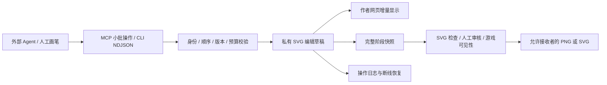

# SVG 笔画流式输出设计

日期：2026-10-05。状态：设计冻结稿；v0.4 已交付的流式协议、验证证据及边界见 [实现与验收记录](ai-tea-drawing-implementation-v04.md)。本文保留设计时的接口提案。

## 推荐方案

用完整的、经过校验的绘图操作作为流式单位，服务维护可编辑草稿，网页增量显示，阶段快照经过审核和游戏权限检查后才公开。最终编译成普通、可编辑 SVG，操作日志负责过程回放。

不要求玩家更换 Agent 或提供模型密钥。基础兼容方式是 MCP 多次提交小批操作；CLI 可逐行接收 NDJSON。真正的模型 token 流只有客户端愿意提供时才接入，不能把所有 Agent 的输出天然当成流。

## 三种流的区别

| 方式 | 实际含义 | 建议 |
| --- | --- | --- |
| 完整 SVG 的渐显动画 | 成品已经到达，网页按路径顺序播放 | 用于回放；猜题时不能把后续完整路径预先发给猜者 |
| 笔画/操作流 | 创作时逐步创建、延长和修改真实几何 | 主方案，兼顾编辑、撤销、上下文与同步 |
| 原始 XML/token 流 | 模型正在输出尚不完整的 SVG 字符串 | 仅作为可选导入适配器，先缓冲并转换，不直接进入共享 DOM |

SVG 路径命令有完整参数语法，错误路径的浏览器容错不应充当应用的协议解析器。[SVG 2 路径规范](https://www.w3.org/TR/SVG2/paths.html)

## 数据流



游戏猜者与传话读图者收到已允许阶段的 PNG。作者可以读自己的 SVG/节点；回合揭晓后才允许学习他人的公开源码和手法。不能先发完整 SVG、再仅靠前端动画隐藏答案。

## 操作单位

先支持创建完整 path/rect/circle、延长 path、修改填充/描边/变换、删除对象、图层排序、撤销重做。每个操作都是完整 JSON，禁止任意属性名、XML、脚本或外部 URL。

路径延长按完整 M/L/C/Q/Z 命令提交；一个 C 命令需要全部六个数值。第一期用绝对坐标，降低相对命令、跨批隐式控制点和椭圆弧的恢复复杂度。导入完整 SVG 仍可以支持已有 sanitizer 接受的命令。

拟定调用：

```json
{"draftId":"opaque-id","seq":1,"baseRevision":0,"operations":[{"op":"add","nodeId":"s1","tag":"path","attrs":{"d":"M 40 60 L 80 90","fill":"none","stroke":"#222222","stroke-width":3}}]}
```

下一批延长 `s1`；每批返回 `acceptedSeq`、新 `revision`、复杂度额度。nodeId 属于编辑模型，不能使用 sanitizer 根据全图哈希重写的 SVG id 作为跨版本身份。

需要两层粒度：对外 Agent 一次提交一个完整笔画或一组小笔画；手绘与专用生成器可以在长笔画内部提交曲线段。填色图形在完成/闭合时显示填充，避免未闭合路径自动闭合产生大片闪烁。填色出现、修改颜色和移动对象属于操作，不能假装全部是按线长增长的笔画。

## Agent 接入边界

MCP 的标准 tools/call 接受完整 arguments。进度通知描述调用进度，不是通用的“模型正在生成的 arguments token”输入协议。服务只能收到宿主实际发出的调用，无法从普通工具配置读取宿主的内部生成流。[MCP 工具](https://modelcontextprotocol.io/specification/2025-11-25/server/tools)、[进度通知](https://modelcontextprotocol.io/specification/2025-11-25/basic/utilities/progress)

- 通用 MCP：open → patch 多次 → preview/checkpoint → submit。建议模型按轮廓、特征、颜色、细节组织小批操作，减少逐点调用开销。
- CLI：同一验证引擎提供逐行 JSON 输入，每行及时返回确认。写入端必须实际 flush；一次写完文件再播放只能称为过程回放。
- 可选 token 适配器：仅在客户端提供生成事件时缓冲完整节点/命令。引号中的 >、XML 注释、defs 依赖等必须由解析器处理，不能通过正则找闭合标签直接上屏。
- 不支持持续运行的 Agent：用户一句话“继续下一阶段”即可，无需后台自动调用模型。

## 流式与审核

- strict：作者看得到自己的实时草稿；其他人看到的是批准后的固定内容哈希。批准 v3 不等于批准未来 v4。
- trusted：已有信任规则仍然适用；允许更频繁的完整阶段提交，不因流式功能自动放开未审公开。
- 图文传话：当前画手私下逐步创作，转交时冻结一张图。下家不收到生成日志、原文或生成意图。
- 你画我猜：同一检查点的 PNG 同时交给猜者，按检查点计分。可播放已公开检查点之间的过程；未来阶段几何不能提前到达猜者电脑。

## 性能与恢复

初始调参目标：作者网页合并显示更新，服务器提交保持小批操作；实际刷新速度取决于 Agent 调用，不承诺模型每秒输出数十笔。浏览器可以平滑显示已有段，平滑不能编造未收到的创作内容。

检查所有数字有限、命令参数完整、节点类型/属性白名单、节点数、路径命令数、最终 SVG 字节数。流量、累计操作数、历史和持久化字节都设上限，不能因为每批小就无限累积。草稿更新使用单独限流，正式发布保留原有限额；当前会话的 2 请求/秒节流也要有明确的批量策略。

每草稿单写者；同时来自网页与 Agent 的编辑使用版本预条件。seq 重复且内容相同返回原确认，内容不同拒绝；乱序拒绝并返回 expectedSeq。掉线读取最新草稿与已确认 seq，再继续；任务过期、退出、换回合后旧流必须拒绝。应用取消只终止接受旧结果，不承诺终止外部 Agent 进程。

浏览器 WebSocket 本身不提供应用级背压，因此用有界队列、合并可替换预览、限制 bufferedAmount 和重新读取快照恢复。不能丢弃仍需执行的几何操作后继续沿用旧版本。[WebSocket API](https://developer.mozilla.org/en-US/docs/Web/API/WebSocket)

第一期复用现有按接收者过滤的快照传输，草稿批量降低频率并限制体积；后续再做增量同步协议。回放日志按提交批次/操作记录，重绘结果必须与最终 SVG 一致。

## 实施顺序与验收

1. 建立共用编辑模型与 patch/undo/redo、完整 SVG 导入导出。
2. 接入作者网页增量预览、MCP 与 NDJSON CLI。
3. 接入批准快照和两种游戏的可见性投影。
4. 增加公开后的操作回放、方法卡和可复用路径示例。

验收包括：首笔在收到第一批后出现；长曲线逐批增长；导出可重新编辑；重放几何一致；重复/乱序/断线不重复落笔；网页与 Agent 冲突不覆盖；隐藏题目不经流、事件、导出、缓存泄漏；未批准草稿不公开；大/恶意流在修改状态前拒绝；lite/portable 包中的实际入口能使用相同接口。
